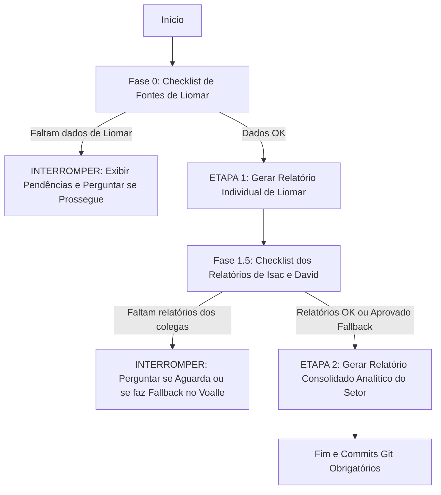

# 📋 PROMPT DE GERAÇÃO DE RELATÓRIOS SEMANAIS - SETOR DE TI

---

## ⚙️ 1. PARÂMETROS DA SEMANA (CAMPOS EDITÁVEIS PELO USUÁRIO)

> [!NOTE]
> Altere os campos abaixo a cada nova semana antes de solicitar a execução da IA.

* **Data Inicial:** `2026-09-01`
* **Data Final:** `2026-09-13`
* **Colaborador Principal (Responsável pela Consolidação):** Liomar Antonio de Oliveira

### 📝 Instruções e Focos Específicos Desta Semana (Customizável):

<!-- Digite aqui orientações contextuais ou pontos de atenção para a execução corrente -->

1. **Relatório de Visitas Presenciais e Veículos:** Ler obrigatoriamente o arquivo [1.voalle/Relatório de Visita Técnica Presencial - Setor TI.md](<file:///home/liomarti/dev/reports_ti/1.voalle/Relat%C3%B3rio%20de%20Visita%20T%C3%A9cnica%20Presencial%20-%20Setor%20TI.md>) e mapear os deslocamentos com veículos da empresa realizados no período de setembro/2026 para alimentar o subtópico de visitas em Suporte Interno.
   - *Obs.:* Caso não hajam dados neste arquivo para o período selecionado, identificar se houveram atendimentos presenciais nos demais dados levantados e registrar no tópico correspondente.
2. **Painéis de BI com Parceiros (Tópico de Projetos):** Manter a justificativa factual real:
   - **Analítica 3M:** Acesso limitado de Liomar; o setor de TI não gerencia e não realiza acompanhamento direto da integração. Ficou pendente de o coordenador de TI Isvi Neemias solicitar a inclusão do contato no grupo de WhatsApp para esta demanda.
   - **EasyBI (MW Solutions):** Acesso nunca recebido funcionalmente, link inacessível por DNS (`https://easybi.teninternet.com.br`), sem participação em grupos e fora do escopo direto de atuação do TI.
   - **Diretriz de Demanda Futura do Coordenador:**
     - *"Vamos verificar as telas pra ajustar o que for necessário. Mas o principal foco: Quero construir uma tela pra o TI, assim como estamos construindo para outros setores (somente no Analítica 3M, por enquanto)."*
     - *"Criar um documento/escopo e solicitar aos BIs para criar a tela, até para termos um benchmarking entre a construção de cada empresa."*
     - *"Se um dia, a tela de BI puder substituir ou servir como principal fonte de dados dos relatórios, vai ser ótimo."*
3. **Mérito do AutoTickets:** Os arquivos `.csv` em [2.autotickets/](file:///home/liomarti/dev/reports_ti/2.autotickets/) são dados tratados, filtrados e preparados pelo próprio sistema AutoTickets para auditoria.

### 📌 Tarefas Extras Pontuais Desta Semana (Customizável):

<!-- Adicione novas tarefas ou tópicos avulsos que surjam nesta semana -->

- [ ] Validar correções recentes no driver da ONT Parks e Datacom implementadas no AutoTickets.
- [ ] Mapear status da migração para o Slack e contas de e-mail criadas.

---

## 🚦 2. GATEKEEPER E FLUXO DE EXECUÇÃO EM DUAS ETAPAS

A IA deve seguir rigorosamente a execução em duas etapas com **validação prévia de fontes (Gatekeeper)**:

### Fase 0: Checklist de Pré-Requisitos (Fontes de Liomar)

Antes de gerar o relatório individual de Liomar, a IA deve validar:

- [ ] **Voalle (`1.voalle/`):** Arquivo PDF/CSV cobrindo o período da semana.
- [ ] **AutoTickets Local (`/home/liomarti/dev/autotickets-v2`):** Commits no período via `git log`.
- [ ] **AutoTickets CSVs (`2.autotickets/*.csv`):** Arquivos de chamados e tarefas atualizados.
- [ ] **WhatsApp (`3.whatsapp_histories/database/msgstore.db`):** Mensagens cobrindo as datas da semana. *(Nota: O database é do WhatsApp corporativo do setor de TI utilizado pelos 3 colaboradores. Tratar como demanda geral atendida pelo setor quando não houver identificação explícita do autor da resposta).*

> [!WARNING]
> **Ponto de Interrupção 1:** Caso falte qualquer uma das fontes acima para Liomar, a IA **DEVE INTERROMPER** a execução imediatamente, listar em tabela o status de cada fonte e perguntar se o usuário deseja prosseguir com dados parciais ou aguardar atualização.

---

### ETAPA 1: Relatório Individual de Liomar Oliveira

1. **Mineração:** Cruzar os dados de Voalle, commits do AutoTickets e histórico do WhatsApp.
2. **Estrutura:** Seguir rigorosamente o padrão analítico e o modelo de tópicos oficiais.
3. **Formatos de Saída:** Salvar os 3 arquivos em `0.individual_report/liomar/[data_inicio]-[data_fim].[ext]` (`.md`, `.html` estilizado e `.pdf` executivo A4).

---

### Fase 1.5: Validação dos Colegas (Gatekeeper de Consolidação)

Antes de gerar o consolidado, a IA deve verificar:

- [ ] Relatório de **Isac Costa Silva** em `0.individual_report/isac/[data_inicio]-[data_fim].[ext]`.
- [ ] Relatório de **David Brasil Fernandes** em `0.individual_report/david/[data_inicio]-[data_fim].[ext]`.

> [!WARNING]
> **Ponto de Interrupção 2:** Se faltar o relatório individual de Isac ou David:
>
> 1. A IA deve **PARAR** a execução;
> 2. Informar quais relatórios não foram encontrados para o período;
> 3. Perguntar interativamente:
>    - *(Opção A)* Aguardar o usuário inserir os relatórios pendentes;
>    - *(Opção B)* Prosseguir realizando a mineração direta das atividades dos colegas no Voalle (`1.voalle/` e `2.autotickets/`) e WhatsApp.

---

### ETAPA 2: Relatório Semanal Consolidado do Setor de TI

1. **Profundidade Analítica (PROIBIDO RESUMIR EXCESSIVAMENTE):** O relatório consolidado deve ser denso, detalhado e aprofundado, cobrindo detalhadamente cada tópico e subtópico com métricas, causas raízes, soluções aplicadas, tabelas e contexto técnico. Não reduza as seções a tópicos genéricos de uma frase.
2. **Consolidação das Entregas e Preservação de Visão:** Integrar Liomar, Isac e David no documento consolidado. A visão detalhada do relatório individual de Liomar deve ser rigorosamente preservada e expandida com as atividades de Isac e David.
3. **Ações Conjuntas:** Quando mais de um colaborador atuou na mesma demanda, descrever em relato unificado indicando a participação e responsabilidade de cada um.
4. **Formatos de Saída:** Criar um subdiretório dedicado para cada semana em `4.weekly_reports/[data_inicio]_[data_fim]/` e salvar os arquivos no padrão `report_ti-[data_inicio]-[data_fim].[ext]` (`.md`, `.html` estilizado e `.pdf` executivo A4), conforme a estrutura `4.weekly_reports/[data_inicio]_[data_fim]/report_ti-[data_inicio]-[data_fim].[ext]`.

---

## 📐 3. ESTRUTURA HIERÁRQUICA E DIRETRIZES VISUAIS DO RELATÓRIO CONSOLIDADO

### 🎨 3.1 Moldura do Topo e Bloco Institucional

A moldura de abertura do documento deve seguir estritamente o padrão corporativo:

* **Título Principal:** Relatório Semanal Consolidado - Setor TI
* **Subtítulo:** Panorama Operacional, Gestão de Demandas, Incidentes, Infraestrutura Crítica e Outros
* **Bloco de Identificação Executiva (4 Cards de Metadados):** Apresentados em formato de tabela/grid sóbrio e corporativo (compatível com documentos formais e A4):
  1. **Período de Referência:** `[Data Inicial] a [Data Final]`
  2. **Coordenador de TI:** `Isvi Neemias`
  3. **Responsável pela Consolidação:** `Liomar Antonio de Oliveira (Analista de TI Sênior)`
  4. **Equipe Integrada:** `Liomar Oliveira, Isac Costa e David Brasil`

### 📑 3.2 Paginação, Diagramação e Renderização PDF

1. **Remoção de Cabeçalho/Rodapé do Navegador no PDF:**
   - Na geração do PDF via Chromium/Playwright, utilizar obrigatoriamente o parâmetro `--no-pdf-header-footer` (ou equivalente no CSS com `@page { margin: 15mm 12mm 15mm 12mm; }`), evitando que datas automáticas e caminhos locais (`file:///...` ou numerações `1/2`) poluam o cabeçalho e rodapé.
   - O próprio design HTML/CSS deve gerenciar cabeçalhos e numeração de página de forma interna e elegante.
2. **Quebra de Página por Tópico Principal:**
   - Cada tópico principal (do Índice ao Tópico 8) deve iniciar em uma nova página através de quebras de página explícitas (`page-break-before: always;` / `break-before: page;`).
3. **Recursos Visuais Obrigatórios:**
   - **Statcards:** No início de cada seção quantitativa, exibir cards com métricas-chave destacadas (números totais, taxas de resolução, volumes por canal).
   - **Gráficos Visuais (CSS/SVG nativos):** Gráficos de barras proporcionais e distribuição setorial (pizza/donut em SVG puro ou CSS flex/grid).
   - **Tabelas Completas e Ricas:** Listagens estruturadas contendo Protocolo/ID, Solicitante/Setor, Descrição Técnica, Responsável e Status.

---

### 📂 3.3 Índice Geral de Navegação (com Links Âncoras)

O relatório deve conter um **Índice Completo** no início, com links internos para todos os tópicos e subtópicos:

* [Resumo Executivo](#resumo-executivo)
* [1. Gestão de Demandas](#1-gestão-de-demandas)
  * [1.1 Demandas Pendentes](#11-demandas-pendentes)
  * [1.2 Demandas em Andamento](#12-demandas-em-andamento)
  * [1.3 Demandas Concluídas](#13-demandas-concluídas)
  * [1.4 Demandas Novas](#14-demandas-novas)
    * [1.4.1 Comparativo Entradas x Saídas](#141-comparativo-entradas-x-saídas)
* [2. Registro de Atividades por Membro da Equipe](#2-registro-de-atividades-por-membro-da-equipe)
  * [2.1 David Brasil Fernandes](#21-david-brasil-fernandes)
    * [2.1.1 Resumo das Atividades](#211-resumo-das-atividades)
    * [2.1.2 Distribuição do Tempo](#212-distribuição-do-tempo)
    * [2.1.3 Desenvolvimento e Capacitação](#213-desenvolvimento-e-capacitação)
  * [2.2 Isac Costa Silva](#22-isac-costa-silva)
    * [2.2.1 Resumo das Atividades](#221-resumo-das-atividades)
    * [2.2.2 Distribuição do Tempo](#222-distribuição-do-tempo)
    * [2.2.3 Desenvolvimento e Capacitação](#223-desenvolvimento-e-capacitação)
  * [2.3 Liomar Antonio de Oliveira](#23-liomar-antonio-de-oliveira)
    * [2.3.1 Resumo das Atividades](#231-resumo-das-atividades)
    * [2.3.2 Distribuição do Tempo](#232-distribuição-do-tempo)
    * [2.3.3 Desenvolvimento e Capacitação](#233-desenvolvimento-e-capacitação)
  * [2.4 Desempenho e Produtividade Comparativa no Voalle](#24-desempenho-e-produtividade-comparativa-no-voalle)
* [3. Projetos e Entregas](#3-projetos-e-entregas)
  * [3.1 Projeto AutoTickets v2 (RADIUS, Automações e Provisionamento)](#31-projeto-autotickets-v2)
    * [3.1.1 Status e Andamento](#311-status-e-andamento)
    * [3.1.2 Entregas em Produção e Resultados](#312-entregas-em-produção-e-resultados)
    * [3.1.3 Distribuição do Tempo](#313-distribuição-do-tempo)
  * [3.2 Projetos de Conectividade e Redes (WireGuard, SSH e Hardening)](#32-projetos-de-conectividade-e-redes)
  * [3.3 Painéis de BI com Parceiros (Analítica 3M e EasyBI / MW Solutions)](#33-painéis-de-bi-com-parceiros)
* [4. Incidentes Tratados](#4-incidentes-tratados)
* [5. Suporte Interno (Informática)](#5-suporte-interno-informática)
  * [5.1 Relação de Incidentes e Chamados da Semana](#51-relação-de-incidentes-e-chamados-da-semana)
  * [5.2 Setores que mais Demandaram Atendimento](#52-setores-que-mais-demandaram-atendimento)
  * [5.3 Colaboradores Solicitantes Mais Frequentes](#53-colaboradores-solicitantes-mais-frequentes)
  * [5.4 Relatório de Visitas Técnicas Presenciais e Gestão de Veículos](#54-relatório-de-visitas-técnicas-presenciais-e-gestão-de-veículos)
* [6. Suporte ao Técnico de Campo](#6-suporte-ao-técnico-de-campo)
  * [6.1 Volumetria de Solicitações (Com e Sem Protocolo)](#61-volumetria-de-solicitações-com-e-sem-protocolo)
  * [6.2 Tipos de Apoio Mais Frequentes e Tempo de Resposta](#62-tipos-de-apoio-mais-frequentes-e-tempo-de-resposta)
  * [6.3 Oportunidades de Automação e Redução de Dependência](#63-oportunidades-de-automação-e-redução-de-dependência)
* [7. Infraestrutura e Sistemas Críticos](#7-infraestrutura-e-sistemas-críticos)
  * [7.1 Disponibilidade de Serviços e Incidentes em Sistemas](#71-disponibilidade-de-serviços-e-incidentes-em-sistemas)
  * [7.2 Execução e Validação de Backups](#72-execução-e-validação-de-backups)
  * [7.3 Atualizações, Melhorias e Ações de Modernização](#73-atualizações-melhorias-e-ações-de-modernização)
* [8. Pontos de Atenção e Próximas Ações](#8-pontos-de-atenção-e-próximas-ações)
  * [8.1 Riscos Tecnológicos e Vulnerabilidades Identificadas](#81-riscos-tecnológicos-e-vulnerabilidades-identificadas)
  * [8.2 Necessidades de Investimentos e Aquisições](#82-necessidades-de-investimentos-e-aquisições)
  * [8.3 Ações Planejadas para as Próximas Semanas](#83-ações-planejadas-para-as-próximas-semanas)

---

### 📝 3.4 Conteúdo Detalhado por Tópico

#### Resumo Executivo

Visão geral analítica da semana: síntese das principais entregas de engenharia de software e infraestrutura, quantitativo global de chamados e suportes a técnicos, principais conquistas e prioridades operacionais para a próxima semana.

#### 1. Gestão de Demandas

* **1.1 Demandas Pendentes:** Demandas paradas ou na fila aguardando início, informando ID/Protocolo, solicitante, prioridade técnica e data prevista.
* **1.2 Demandas em Andamento:** Atividades em execução, indicando responsável direto, percentual de avanço estimado, bloqueios técnicos ou dependências de terceiros e previsão de conclusão.
* **1.3 Demandas Concluídas:** Todas as entregas finalizadas na semana com detalhamento do resultado prático obtido.
* **1.4 Demandas Novas:** Demandas abertas durante o período avaliado.
  * **1.4.1 Comparativo Entradas × Saídas:** Análise quantitativa demonstrando se a fila de trabalho do setor está crescendo ou reduzindo (com statcards e balanço líquido).

#### 2. Registro de Atividades por Membro da Equipe

Para cada colaborador (**2.1 David Brasil Fernandes**, **2.2 Isac Costa Silva** e **2.3 Liomar Antonio de Oliveira**), detalhar:

* **Resumo das Atividades:** Narrativa aprofundada dos chamados, projetos e intervenções técnicas realizadas.
* **Distribuição do Tempo:** Percentual de alocação entre frentes (Projetos, Suporte Interno, Suporte ao Campo, Infraestrutura e Rotinas Administrativas).
* **Desenvolvimento e Capacitação:** Dificuldades observadas, pontos fortes demonstrados e necessidades de treinamento identificadas.
* **2.4 Desempenho e Produtividade Comparativa no Voalle:** Gráfico comparativo e ranking com total de horas apontadas, quantidade de chamados concluídos e análise de engajamento no ERP.

#### 3. Projetos e Entregas

* **Detalhamento por Projeto (3.1, 3.2...):** Identificar projetos ativos (ex.: AutoTickets v2, Automação RADIUS/FreeRADIUS, Hardening de Roteadores/SSH, WireGuard).
  * **Status e Andamento:** Fases do ciclo de vida, protocolos associados parados há tempo, análise de relatos e status atual.
  * **Entregas em Produção:** O que foi efetivamente disponibilizado em ambiente produtivo, melhorias observadas e dependências externas pendentes.
  * **Distribuição do Tempo do Projeto:** Horas investidas na iniciativa.
* **3.3 Painéis de BI com Parceiros:** Esclarecimento formal do status real de **Analítica 3M** (acesso restrito, aguardando grupo de WhatsApp com Isvi Neemias) e **EasyBI / MW Solutions** (inacessível via DNS, ausência de credenciais), incluindo as diretrizes estratégicas e visão de benchmarking futuro da coordenação de TI.

#### 4. Incidentes Tratados

Detalhamento de cada incidente ocorrido na semana:

* Identificação, sistema/serviço afetado, severidade, data/hora e impacto na operação.
* Causa raiz técnica identificada.
* Solução adotada (definitiva ou paliativa/contorno).
* Classificação de recorrência (incidente novo vs. recorrente) e respectivo plano de eliminação/mitigação.

#### 5. Suporte Interno (Informática)

* **5.1 Relação de Incidentes e Chamados:** Análise dos atendimentos a usuários internos (estações de trabalho, acessos, e-mails, sistemas operacionais e periféricos), com causa e solução de cada ocorrência.
* **5.2 Setores que mais Demandaram:** Ranking e gráfico visual dos departamentos mais demandantes (Marketing, NOC, Atendimento, Estoque, etc.).
* **5.3 Colaboradores Solicitantes Mais Frequentes:** Ranking nominal identificando setor e tipo de demanda.
* **5.4 Relatório de Visitas Técnicas Presenciais e Gestão de Veículos:** Subtópico obrigatório com atendimentos presenciais, deslocamentos operacionais, quilometragem/veículo utilizado (ex.: Fiat Palio, Honda Bros) e alertas sobre a frota da empresa.

#### 6. Suporte ao Técnico de Campo

* **6.1 Volumetria de Solicitações:** Quantidade total de apoios prestados via WhatsApp (*ServiceDesk Suporte ao técnico*) e Voalle, diferenciando atendimentos com abertura de protocolo e atendimentos rápidos informais.
* **6.2 Tipos de Apoio Mais Frequentes e Tempo Médio de Resposta:** Provisionamento de ONTs Datacom/Parks, manobras de CTO, consultas cadastrais, liberação de portas e trocas de estrutura.
* **6.3 Oportunidades de Automação e Capacitação:** Propostas práticas de melhorias no AutoTickets ou treinamentos de campo para diminuir a dependência dos técnicos em relação à equipe de TI.

#### 7. Infraestrutura e Sistemas Críticos

* **7.1 Disponibilidade de Serviços e Incidentes em Sistemas:** Monitoramento e saúde de Voalle, Flashman, PBX, Grafana/Made4NOC, MailCow, switches e servidores Datacom/Dell/SuperMicro.
* **7.2 Execução e Validação de Backups:** Status dos backups rotineiros, integridade dos dumps e plano de recuperação.
* **7.3 Atualizações, Melhorias e Ações de Modernização:** Aplicações de patches, reorganização de infraestrutura, cabeamento e melhorias em andamento.

#### 8. Pontos de Atenção e Próximas Ações

* **8.1 Riscos Tecnológicos e Vulnerabilidades Identificadas:** Registro aprofundado de vulnerabilidades críticas (ex.: incidente de varredura/ataques SSH nos MikroTik e medidas de contenção).
* **8.2 Necessidades de Investimentos e Aquisições:** Equipamentos, licenças, upgrades de hardware e insumos demandados.
* **8.3 Ações Planejadas para as Próximas Semanas:** Roadmap de entregas e cronograma de prioridades do setor para os períodos subsequentes.

---

## ⚖️ 4. REGRAS EXPLÍCITAS DE AUDITORIA, FIDEDIGNIDADE E VERSIONAMENTO

1. **Fidelidade Total aos Fatos:** Nunca inventar dados, estimativas ou ocorrências. O relatório deve ser 100% comprovável através de evidências reais.
2. **Fontes Auditáveis Obrigatórias:** Toda afirmação deve vir acompanhada de sua origem precisa:
   - Protocolo Voalle (ex.: `Protocolo #3183637`);
   - Hash de commit do Git no AutoTickets (ex.: `commit a1b2c3d`);
   - Timestamp e canal de WhatsApp (ex.: `ServiceDesk, 08/09 às 09:50`).
3. **Ausência Justificada:** Caso não hajam demandas compatíveis em um tópico em determinado período, registrar formalmente a justificativa técnica em vez de omitir o tópico ou simular atividades inexistentes.
4. **Preservação da Visão Individual:** O relatório semanal consolidado não deve canibalizar ou diminuir as entregas técnicas do relatório individual de Liomar, mas sim incorporá-las integralmente e enriquecê-las com a visão macro do setor.
5. **Commits Automáticos e Imediatos:** Toda alteração em documentos, relatórios ou no próprio `PROMPT.md` **DEVE SER OBRIGATORIAMENTE COMMITADA NO GIT** com mensagem clara e descritiva.
