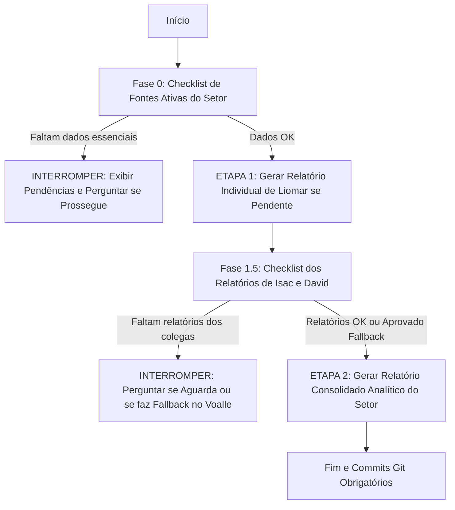

# 📋 PROMPT DE GERAÇÃO DE RELATÓRIOS SEMANAIS - SETOR DE TI

---

## ⚙️ 1. PARÂMETROS DA SEMANA (CAMPOS EDITÁVEIS PELO USUÁRIO)

> [!NOTE]
> Altere os campos abaixo a cada nova semana antes de solicitar a execução da IA.

* **Data Inicial (Domingo Oficial):** `2026-10-04`
* **Data Final (Sábado Oficial):** `2026-10-10`
* **Período Operacional Efetivo do TI (Segunda a Sexta):** `2026-10-05` a `2026-10-09`
* **Semana do Ano:** Semana 41 / 2026
* **Colaborador Principal (Responsável pela Consolidação):** Liomar Antonio de Oliveira

### 📝 Instruções e Focos Específicos Desta Semana (Customizável):

<!-- Digite aqui orientações contextuais ou pontos de atenção para a execução corrente -->

1. **Macro-Tópico 4 Dedicado à Plataforma e Automações AutoTickets:**
   - **4.1 Desenvolvimento e Engenharia de Software AutoTickets v2:** Mapear os commits no repositório local `/home/liomarti/dev/autotickets-v2` no período de 04/10 a 10/10/2026 (Sprints 315 a 332: Motor de Glassmorphism, Design System Showcase, integração Ollama GPU com RAG vetorial, governança de cotas Gemini, gateway LiteLLM, gateway SMTP dinâmico na Sprint 208, simplificação executiva na Sprint 331 e busca inteligente por equipes na Sprint 332).
   - **4.2 Automação WiFeed – Hotspots e Sincronização Diária de Vouchers:** Dedicar seção exclusiva com contextualização institucional do Captive Portal TEN_Wi-Fi (para que serve, como funciona a autenticação por voucher/CPF para clientes e por celular para não-clientes), problema operacional anterior (upload manual de CSV, risco de propaganda enganosa/desalinhamento, tempo perdido), solução implementada pelo AutoTickets, resumo executivo da base (32.512 a 32.600 clientes ativos, +88 no período, 100% sucesso, 227.483 vouchers transmitidos), **gráfico SVG de evolução diária da base** (extraído do arquivo HTML) e histórico detalhado de envios e validações na íntegra.
   - **4.3 Módulo Fullcam – Auditoria Financeira de Lucros e Prejuízos:** Incluir diagnóstico financeiro executivo inicial com statcards consolidados (Faturamento: R$ 10.612,36, Custo de Licenças/Storage: R$ 2.209,00, Prejuízo de Equipamentos Perdidos: R$ 1.350,00, Saldo Líquido: +R$ 7.053,36, análise de 51 clientes deficitários vs 34 superavitários) e a **Tabela Completa de Auditoria de 85 clientes na íntegra** com formatação compacta estilizada, quebras de página limpas e cores semânticas no saldo líquido.
   - **4.4 Módulo Fullcam – Produção Operacional das Automações:** Painel Consolidado de Produção com statcards das checagens horárias de esteira (inadimplência e instalação) + tabela detalhada com todas as ações operacionais efetivas (bloqueios, desbloqueios e instalações com cliente, contrato e protocolo), sintetizando as centenas de checagens horárias automáticas (NOTIFY) em indicadores de estabilidade da esteira.
   - **4.5 Impacto Operacional e Produtividade:** Quantificação em horas humanas economizadas pelas rotinas automatizadas.
2. **Cruzamento Analítico de Tickets (`colaborador_x_ticket` + `1.voalle/`):**
   - O relatório analítico `2.autotickets/colaborador_x_ticket/` deve ser lido complementarmente com os dados de `1.voalle/`.
   - Utilizar `colaborador_x_ticket` como fonte primária consolidada para as métricas do Tópico 1 (Balanço da fila de 120,5% — 73 entradas × 88 saídas) e para o resumo sintético do Tópico 2 (produtividade por colaborador, TMA, TMR e taxa de resolubilidade).
   - Utilizar as exportações brutas em `1.voalle/` para extrair as narrativas detalhadas, protocolos individuais, justificativas técnicas de tempo e apontamentos de cada integrante.
3. **Regra Multi-Formato de Arquivos:**
   - Arquivos com o mesmo nome e formatos diferentes em `2.autotickets/` (ex.: `.md`, `.html`, `.csv`, `.pdf`) são o mesmo relatório consolidado sobre os mesmos dados. A IA deve verificar apenas as particularidades entre eles (como gráficos SVG no HTML ou colunas adicionais no CSV) e tratá-los de forma unificada, sem duplicar o processamento.
4. **Relatório de Visitas Presenciais e Veículos (Tópico 6):** Identificar nos apontamentos do Voalle os deslocamentos operacionais, quilometragem, veículos utilizados e registrar formalmente as dificuldades e atrasos gerados pela frota.
5. **Investigações de Segurança e Vulnerabilidades:** Mapear estudos técnicos pontuais em `2.1.others/` datados no período da semana para integrar aos tópicos de projetos, segurança e infraestrutura.

---

## 🚦 2. GATEKEEPER E FLUXO DE EXECUÇÃO EM DUAS ETAPAS

A IA deve seguir rigorosamente a execução em duas etapas com **validação prévia de fontes (Gatekeeper)**:

### Fase 0: Checklist de Pré-Requisitos (Fontes Ativas)

> [!NOTE]
> **Aproveitamento de Relatório Existente:** Caso já exista arquivo de relatório para o colaborador no período em `0.individual_report/[colaborador]/` (em formato `.pdf`, `.md` ou `.html`), **não é necessário gerar um novo relatório individual**. O arquivo existente deve ser aproveitado e considerado diretamente na confecção do relatório semanal em `4.weekly_reports/`.

Antes de gerar o relatório individual de Liomar (caso ainda não exista para o período), a IA deve validar:

- [ ] **Voalle (`1.voalle/liomar/`):** Arquivo de apontamentos e atendimentos no período em formato `.html`, `.pdf` ou `.csv` (ex.: `Liomar-2026-10-04_2026-10-10.html`).
- [ ] **AutoTickets Local (`/home/liomarti/dev/autotickets-v2`):** Commits no período de 04/10 a 10/10/2026 ou relatório de engenharia de software.
- [ ] **AutoTickets Relatórios Analíticos (`2.autotickets/`):**
  - [ ] `2.autotickets/colaborador_x_ticket/`: Cruzamento de produtividade e tickets por colaborador no período.
  - [ ] `2.autotickets/wifeed_daily_update_voucher/`: Relatório de vouchers WiFeed (.md e .html com gráfico SVG).
  - [ ] `2.autotickets/fullcam_lucros_prejuizos/`: Auditoria financeira de contratos e equipamentos (.csv e .pdf).
  - [ ] `2.autotickets/fullcam_automacao_inadimplencia/`: Relatórios de esteira de inadimplência (.md, .csv, .html).
  - [ ] `2.autotickets/fullcam_automacao_instalacao_camera/`: Relatórios de instalação de câmeras (.md, .csv, .html).
- [ ] **Investigações Pontuais (`2.1.others/`):** Verificar existência de pastas datadas da semana.
- [ ] **Feedbacks Anteriores (`5.feedback/`):** Leitura de apontamentos do Coordenador Isvi Neemias para garantir aderência às diretrizes de governança.

> [!IMPORTANT]
> **Regra sobre `miscelaneous/`:** O diretório `miscelaneous/` (históricos de WhatsApp, gateway LiteLLM) é um repositório frio de apoio e **NÃO DEVE SER LIDO AUTOMATICAMENTE** nesta fase, exceto se solicitado expressamente nas instruções da semana.

> [!WARNING]
> **Ponto de Interrupção 1:** Caso falte qualquer uma das fontes ativas essenciais para Liomar (e ele não possua relatório existente no período), a IA **DEVE INTERROMPER** a execução imediatamente, listar em tabela o status de cada fonte e perguntar se o usuário deseja prosseguir com dados parciais ou aguardar atualização.

---

### ETAPA 1: Relatório Individual de Liomar Oliveira

*(Pular esta etapa se já existir relatório individual de Liomar para o período em `0.individual_report/liomar/`)*

1. **Mineração:** Cruzar os dados de Voalle, commits do AutoTickets, tarefas de banco de dados e investigações.
2. **Estrutura:** Seguir rigorosamente o padrão analítico e o modelo de tópicos oficiais.
3. **Formatos de Saída:** Salvar os 3 arquivos em `0.individual_report/liomar/[data_inicio]_[data_fim].[ext]` (`.md`, `.html` estilizado e `.pdf` executivo A4).

---

### Fase 1.5: Validação dos Colegas (Gatekeeper de Consolidação)

Antes de gerar o consolidado, a IA deve verificar se os colegas já possuem relatórios para o período:

- [ ] Relatório de **Isac Costa Silva** em `0.individual_report/isac/[data_inicio]_[data_fim].[ext]`.
- [ ] Relatório de **David Brasil Fernandes** em `0.individual_report/david/[data_inicio]_[data_fim].[ext]`.

> [!TIP]
> Se o arquivo de Isac ou David já existir (seja `.pdf`, `.md` ou `.html`), ele é considerado pronto: **não é gerado novo relatório** e suas informações são integradas diretamente ao consolidado semanal.

> [!WARNING]
> **Ponto de Interrupção 2:** Se faltar o relatório individual de Isac ou David:
>
> 1. A IA deve **PARAR** a execução;
> 2. Informar quais relatórios não foram encontrados para o período;
> 3. Perguntar interativamente:
>    - *(Opção A)* Aguardar o usuário inserir os relatórios pendentes;
>    - *(Opção B)* Prosseguir realizando a mineração direta das atividades dos colegas no Voalle (`1.voalle/[colaborador]/`) e relatórios do AutoTickets.

---

### ETAPA 2: Relatório Semanal Consolidado do Setor de TI

1. **Profundidade Analítica (PROIBIDO RESUMIR EXCESSIVAMENTE):** O relatório consolidado deve ser denso, detalhado e aprofundado, cobrindo detalhadamente cada tópico e subtópico com métricas, causas raízes, soluções aplicadas, tabelas e contexto técnico. Não reduza as seções a tópicos genéricos de uma frase.
2. **Consolidação das Entregas e Preservação de Visão:** Integrar Liomar, Isac e David no documento consolidado. A visão detalhada do relatório individual de Liomar deve ser rigorosamente preservada e expandida com as atividades de Isac e David.
3. **Ações Conjuntas:** Quando mais de um colaborador atuou na mesma demanda, descrever em relato unificado indicando a participação e responsabilidade de cada um.
4. **Formatos de Saída:** Criar o subdiretório dedicado para a semana em `4.weekly_reports/[data_inicio]_[data_fim]/` (onde o padrão de data é Domingo a Sábado) e salvar os arquivos no padrão `report_ti-[data_inicio]-[data_fim].[ext]` (`.md`, `.html` estilizado e `.pdf` executivo A4).

---

## 📐 3. ESTRUTURA HIERÁRQUICA E DIRETRIZES VISUAIS DO RELATÓRIO CONSOLIDADO

### 🎨 3.1 Moldura do Topo e Bloco Institucional

A moldura de abertura do documento deve seguir estritamente o padrão corporativo:

* **Título Principal:** Relatório Semanal Consolidado - Setor TI
* **Subtítulo:** Panorama Operacional, Gestão de Demandas, Incidentes, Infraestrutura Crítica e Outros
* **Bloco de Identificação Executiva (Grid Corporativo em Tabela):**
  - **Período Oficial (Diretoria):** `[Data Inicial Domingo] a [Data Final Sábado] (Semana XX / AAAA)`
  - **Período Operacional Efetivo do TI:** `[Segunda-feira] a [Sexta-feira] (Expediente Útil do Setor)`
  - **Coordenador de TI:** `Isvi Neemias`
  - **Responsável pela Consolidação:** `Liomar Antonio de Oliveira (Analista de TI Sênior — ID #107184)`
  - **Equipe Integrada:** `Liomar Oliveira, Isac Costa Silva e David Brasil Fernandes`

### 📑 3.2 Paginação, Diagramação e Renderização PDF

1. **Remoção de Cabeçalho/Rodapé do Navegador no PDF:**
   - Na geração do PDF via Chromium/Playwright, utilizar obrigatoriamente o parâmetro `--no-pdf-header-footer` (ou equivalente no CSS com `@page { margin: 15mm 12mm 15mm 12mm; }`), evitando que datas automáticas e caminhos locais (`file:///...` ou numerações `1/2`) poluam o cabeçalho e rodapé.
   - O próprio design HTML/CSS deve gerenciar cabeçalhos e numeração de página de forma interna e elegante.
2. **Quebra de Página por Tópico Principal:**
   - Cada tópico principal deve iniciar em uma nova página através de quebras de página explícitas (`page-break-before: always;` / `break-before: page;`).
3. **Recursos Visuais Obrigatórios:**
   - **Statcards:** No início de cada seção quantitativa, exibir cards com métricas-chave destacadas (números totais, balanço de fila, horas economizadas).
   - **Gráficos Visuais (CSS/SVG nativos):** Gráficos de barras proporcionais e distribuição setorial (pizza/donut em SVG puro ou CSS flex/grid).
   - **Tabelas Completas e Ricas:** Listagens estruturadas contendo Protocolo/ID, Solicitante/Setor, Descrição Técnica, Responsável e Status.

---

### 📂 3.3 Índice Geral de Navegação (com Links Âncoras 100% Funcionais)

O relatório deve conter um **Índice Completo** no início, com links internos rigorosamente correspondentes aos títulos do corpo do texto:

* [Resumo Executivo](#resumo-executivo)
* [⭐ Fatos Notáveis e Anomalias da Semana](#-fatos-notáveis-e-anomalias-da-semana)
* [1. Gestão de Demandas](#1-gestão-de-demandas)
  * [1.1 Demandas Pendentes](#11-demandas-pendentes)
  * [1.2 Demandas em Andamento](#12-demandas-em-andamento)
  * [1.3 Demandas Concluídas](#13-demandas-concluídas)
  * [1.4 Demandas Novas](#14-demandas-novas)
    * [1.4.1 Comparativo Entradas × Saídas (Balanço da Fila)](#141-comparativo-entradas--saídas-balanço-da-fila)
* [2. Registro de Atividades por Membro da Equipe](#2-registro-de-atividades-por-membro-da-equipe)
  * [2.1 David Brasil Fernandes](#21-david-brasil-fernandes)
    * [2.1.1 Resumo das Atividades](#211-resumo-das-atividades)
    * [2.1.2 Distribuição do Tempo](#212-distribuição-do-tempo)
    * [2.1.3 Desenvolvimento e Capacitação](#213-desenvolvimento-e-capacitação)
  * [2.2 Isac Costa Silva](#22-isac-costa-silva)
    * [2.2.1 Resumo das Atividades](#221-resumo-das-atividades)
    * [2.2.2 Distribuição do Tempo](#222-distribuição-do-tempo)
    * [2.2.3 Desenvolvimento e Capacitação](#223-desenvolvimento-e-capacitação)
  * [2.3 Liomar Antonio de Oliveira](#23-liomar-antonio-de-oliveira)
    * [2.3.1 Resumo das Atividades](#231-resumo-das-atividades)
    * [2.3.2 Distribuição do Tempo](#232-distribuição-do-tempo)
    * [2.3.3 Desenvolvimento e Capacitação](#233-desenvolvimento-e-capacitação)
  * [2.4 Desempenho no Voalle e Confronto com Jornada Real (Pontomais)](#24-desempenho-no-voalle-e-confronto-com-jornada-real-pontomais)
* [3. Projetos e Entregas](#3-projetos-e-entregas)
  * [3.1 Projetos de Conectividade e Redes (WireGuard, SSH e Hardening)](#31-projetos-de-conectividade-e-redes)
  * [3.2 Telefonia Fixa e Comunicação Corporativa (Native PBX / ZEUS)](#32-telefonia-fixa-e-comunicação-corporativa)
  * [3.3 Painéis de BI com Parceiros (Analítica 3M e EasyBI / MW Solutions)](#33-painéis-de-bi-com-parceiros)
* [4. Plataforma e Automações AutoTickets](#4-plataforma-e-automações-autotickets)
  * [4.1 Desenvolvimento e Engenharia de Software AutoTickets v2](#41-desenvolvimento-e-engenharia-de-software-autotickets-v2)
    * [4.1.1 Entregas em Produção, Commits e Sprints](#411-entregas-em-produção-commits-e-sprints)
    * [4.1.2 Evolução Arquitetural, IA e Governança de Software](#412-evolução-arquitetural-ia-e-governança-de-software)
  * [4.2 Automação WiFeed – Hotspots e Sincronização Diária de Vouchers](#42-automação-wifeed--hotspots-e-sincronização-diária-de-vouchers)
    * [4.2.1 Contexto Institucional e Problema Operacional do Captive Portal](#421-contexto-institucional-e-problema-operacional-do-captive-portal)
    * [4.2.2 Solução Automatizada Desenvolvida no AutoTickets](#422-solução-automatizada-desenvolvida-no-autotickets)
    * [4.2.3 Resumo Executivo e Métricas da Base de Clientes](#423-resumo-executivo-e-métricas-da-base-de-clientes)
    * [4.2.4 Evolução Diária da Base de Clientes Ativos (Gráfico SVG)](#424-evolução-diária-da-base-de-clientes-ativos-gráfico-svg)
    * [4.2.5 Histórico Detalhado de Envios e Validações de Vouchers](#425-histórico-detalhado-de-envios-e-validações-de-vouchers)
  * [4.3 Módulo Fullcam – Auditoria Financeira de Lucros e Prejuízos](#43-módulo-fullcam--auditoria-financeira-de-lucros-e-prejuízos)
    * [4.3.1 Diagnóstico Financeiro Executivo e Indicadores-Chave](#431-diagnóstico-financeiro-executivo-e-indicadores-chave)
    * [4.3.2 Tabela Completa de Auditoria de Contratos e Saldo Líquido na Íntegra](#432-tabela-completa-de-auditoria-de-contratos-e-saldo-líquido-na-íntegra)
  * [4.4 Módulo Fullcam – Produção Operacional das Automações](#44-módulo-fullcam--produção-operacional-das-automações)
    * [4.4.1 Painel Consolidado de Execução e Disponibilidade da Esteira](#441-painel-consolidado-de-execução-e-disponibilidade-da-esteira)
    * [4.4.2 Ações Efetivas de Inadimplência e Instalações de Câmeras](#442-ações-efetivas-de-inadimplência-e-instalações-de-câmeras)
  * [4.5 Impacto Operacional e Métricas de Produtividade das Automações](#45-impacto-operacional-e-métricas-de-produtividade-das-automações)
* [5. Incidentes Tratados](#5-incidentes-tratados)
* [6. Suporte Interno (Informática)](#6-suporte-interno-informática)
  * [6.1 Relação de Atendimentos e Chamados da Semana](#61-relação-de-atendimentos-e-chamados-da-semana)
  * [6.2 Setores que mais Demandaram Atendimento](#62-setores-que-mais-demandaram-atendimento)
  * [6.3 Colaboradores Solicitantes Mais Frequentes](#63-colaboradores-solicitantes-mais-frequentes)
  * [6.4 Relatório de Visitas Técnicas Presenciais e Gestão de Veículos](#64-relatório-de-visitas-técnicas-presenciais-e-gestão-de-veículos)
* [7. Suporte ao Técnico de Campo](#7-suporte-ao-técnico-de-campo)
  * [7.1 Volumetria de Solicitações (Com e Sem Protocolo)](#71-volumetria-de-solicitações-com-e-sem-protocolo)
  * [7.2 Tipos de Apoio Mais Frequentes e Tempo de Resposta](#72-tipos-de-apoio-mais-frequentes-e-tempo-de-resposta)
  * [7.3 Oportunidades de Automação e Redução de Dependência](#73-oportunidades-de-automação-e-redução-de-dependência)
* [8. Infraestrutura e Sistemas Críticos](#8-infraestrutura-e-sistemas-críticos)
  * [8.1 Disponibilidade de Serviços e Incidentes em Sistemas](#81-disponibilidade-de-serviços-e-incidentes-em-sistemas)
  * [8.2 Execução e Validação de Backups](#82-execução-e-validação-de-backups)
  * [8.3 Atualizações, Melhorias e Ações de Modernização](#83-atualizações-melhorias-e-ações-de-modernização)
* [9. Pontos de Atenção e Próximas Ações](#9-pontos-de-atenção-e-próximas-ações)
  * [9.1 Riscos Tecnológicos e Vulnerabilidades Identificadas](#91-riscos-tecnológicos-e-vulnerabilidades-identificadas)
  * [9.2 Necessidades de Investimentos e Aquisições](#92-necessidades-de-investimentos-e-aquisições)
  * [9.3 Ações Planejadas para as Próximas Semanas](#93-ações-planejadas-para-as-próximas-semanas)

---

### 📝 3.4 Conteúdo Detalhado por Tópico

#### Resumo Executivo
Visão geral analítica da semana: síntese das principais entregas de engenharia de software e infraestrutura, quantitativo global de chamados e suportes a técnicos, principais conquistas e prioridades operacionais para a próxima semana.

#### ⭐ Fatos Notáveis e Anomalias da Semana
Seção obrigatória dedicada ao aprofundamento de ocorrências incomuns. Para cada fato notável identificado no período (desvio de planejamento, atraso de frota, falha física atípica, contestação indevida de cliente ou incidente de segurança):
- **Ocorrência e Ativos Envolvidos:** O que aconteceu, data e equipamentos/sistemas impactados.
- **Causa Raiz Técnica e Contexto:** Por que ocorreu e fatores determinantes.
- **Impacto Operacional:** Horas perdidas, retrabalho ou risco gerado.
- **Tratativa Aplicada:** Medida de contenção imediata ou definitiva.
- **Recomendação e Próximo Passo:** Ação estruturante recomendada para evitar repetição.

#### 1. Gestão de Demandas
- **1.1 Demandas Pendentes:** Demandas paradas ou na fila aguardando início, informando ID/Protocolo, solicitante, prioridade técnica e data prevista.
- **1.2 Demandas em Andamento:** Atividades em execução, indicando responsável direto, percentual de avanço estimado, bloqueios técnicos ou dependências de terceiros e previsão de conclusão.
- **1.3 Demandas Concluídas:** Todas as entregas finalizadas na semana com detalhamento do resultado prático obtido. Demandas de rotina repetitiva de mesma natureza (ex.: análises periciais de desconto de fatura ou atribuições de IP público) podem ser sintetizadas com contagem total e amostragem de protocolos.
- **1.4 Demandas Novas:** Demandas abertas durante o período avaliado.
  - **1.4.1 Comparativo Entradas × Saídas (Balanço da Fila):** Análise quantitativa demonstrando se a fila de trabalho do setor está crescendo ou reduzindo (com statcards e balanço líquido). **PROIBIDO usar o termo "resolutividade".** A fonte primária de vazão deve ser respaldada por `2.autotickets/colaborador_x_ticket/` (ex.: 73 entradas × 88 saídas = 120,5% de vazão).

#### 2. Registro de Atividades por Membro da Equipe
Para cada colaborador (**2.1 David Brasil Fernandes**, **2.2 Isac Costa Silva** e **2.3 Liomar Antonio de Oliveira**), detalhar:
- **Resumo das Atividades:** Narrativa aprofundada dos chamados, projetos e intervenções técnicas realizadas, integrando os dados de `1.voalle/[colaborador]/` enriquecidos pelos indicadores sintéticos de `2.autotickets/colaborador_x_ticket/` (total de ações, chamados atuados, TMA, TMR e resolubilidade).
- **Distribuição do Tempo:** Percentual de alocação entre frentes (Projetos, Suporte Interno, Suporte ao Campo, Infraestrutura e Rotinas Administrativas).
- **Desenvolvimento e Capacitação:** Dificuldades observadas, pontos fortes demonstrados e necessidades de treinamento identificadas.
- **2.4 Desempenho no Voalle e Confronto com Jornada Real (Pontomais):**
  - Tabela comparando Horas no Voalle x Horas no Pontomais.
  - Justificativa técnica obrigatória para divergências (cronômetros de tickets abertos, sobreposição de demandas em paralelo, deslocamentos ou atendimentos em intervalos).

#### 3. Projetos e Entregas
- **3.1 Projetos de Conectividade e Redes:** WireGuard, MikroTik, hardening e SIEM Wazuh. Justificar formalmente qualquer alteração de cronograma ou prioridade técnica (ex.: foco em RBs locais em vez de filiais) e registrar o novo prazo pactuado.
- **3.2 Telefonia Fixa e Comunicação Corporativa (Native PBX / ZEUS):** Diagnóstico de estabilidade, migrações de ramais e suporte telefônico corporativo.
- **3.3 Painéis de BI com Parceiros:** Esclarecimento formal do status real de **Analítica 3M** (Perfil Master para gestão de usuários, escopo estratégico) e **EasyBI / MW Solutions** (fora do escopo direto, descontinuação contratual).

#### 4. Plataforma e Automações AutoTickets
Macro-tópico de alto valor estratégico para a empresa, detalhando em subtópicos dedicados na íntegra:
- **4.1 Desenvolvimento e Engenharia de Software AutoTickets v2:**
  - **4.1.1 Entregas em Produção, Commits e Sprints:** Mapeamento minucioso dos commits no git (`autotickets-v2`) no período avaliado. Relação de sprints entregues (Sprints 315 a 332), volume de adições/remoções de código, arquivos impactados e testes executados com `DatabaseTransactions`.
  - **4.1.2 Evolução Arquitetural, IA e Governança de Software:** Detalhamento do motor de Glassmorphism, Design System corporativo, integração Ollama GPU com RAG vetorial, governança de cotas Gemini, gateway LiteLLM e servidor oficial MCP (`laravel/mcp`).
- **4.2 Automação WiFeed – Hotspots e Sincronização Diária de Vouchers:**
  - **4.2.1 Contexto Institucional e Problema Operacional do Captive Portal:** Explicar a função do WiFeed como Captive Portal da Ten Internet para captura de leads e fidelização (rede "TEN_Wi-Fi"), diferenciando o fluxo de não-clientes (cadastro por celular) e clientes (validação via CPF do titular com base de vouchers). Detalhar o problema operacional anterior (geração e upload 100% manual de arquivos CSV de CPFs sanitizados, risco de sensação de "propaganda enganosa" para assinantes recentes e perda de tempo técnico do TI).
  - **4.2.2 Solução Automatizada Desenvolvida no AutoTickets:** Descrever a arquitetura da automação: conexão direta ao banco Voalle, filtro exclusivo de clientes adimplentes em qualquer plano, sanitização estrita de CPFs/CNPJs, rotina agendada diária às 11h, exclusão do segmento antigo, upload do novo lote, paginação de integridade linha por linha e comutação segura para o segmento ativo.
  - **4.2.3 Resumo Executivo e Métricas da Base de Clientes:** Statcards com Clientes Ativos Início (32.512), Clientes Ativos Fim (32.600), Variação Líquida (+88 / +0.27%), Pico (32.600), Mínimo (32.334), Sincronizações Executadas (7), Taxa de Sucesso (100%) e Vouchers Transmitidos (227.483).
  - **4.2.4 Evolução Diária da Base de Clientes Ativos (Gráfico SVG):** Reprodução fiel do gráfico visual de área e linhas em SVG puro, com escala de clientes (32.312 a 32.622), curva de crescimento e marcação dos dias do período avaliado.
  - **4.2.5 Histórico Detalhado de Envios e Validações de Vouchers:** Tabela completa na íntegra registrando Data/Hora, Operador, Segmento, Base ERP, Vouchers Transmitidos, Taxa de Sucesso (100%), Status e Observações.
- **4.3 Módulo Fullcam – Auditoria Financeira de Lucros e Prejuízos:**
  - **4.3.1 Diagnóstico Financeiro Executivo e Indicadores-Chave:** Síntese executiva com statcards do parque auditado: Total Faturado (R$ 10.612,36), Custo de Licenças Fullcam (R$ 1.875,00), Custo de Storage em Nuvem (R$ 334,00), Prejuízo com Equipamentos Perdidos (R$ 1.350,00) e Saldo Líquido Consolidado (+R$ 7.053,36). Análise crítica de risco evidenciando que 51 clientes operam com saldo negativo (contratos cancelados/bloqueados gerando custos residuais de licença/storage ou perda de hardware) contra 34 clientes superavitários.
  - **4.3.2 Tabela Completa de Auditoria de Contratos e Saldo Líquido na Íntegra:** Transcrição completa e sem omissões de todos os 85 registros auditados em tabela compacta estilizada (Cliente, CPF/CNPJ mascarado, Contratos Voalle, Faturas Pagas, GB Consumido, Valor Faturado, Custo de Licenças, Custo de Storage, Equip. Perdido e Saldo Líquido). Aplicar cores semânticas (verde para saldos positivos, vermelho para negativos) e diagramação limpa para paginação A4.
- **4.4 Módulo Fullcam – Produção Operacional das Automações:**
  - **4.4.1 Painel Consolidado de Execução e Disponibilidade da Esteira:** Statcards globais sintetizando a volumetria da esteira automatizada (Total de 553 checagens e rotinas processadas no período, 32 câmeras tratadas, taxa de sucesso operacional de 99,2% na esteira de inadimplência e disponibilidade ininterrupta das rotinas de instalação).
  - **4.4.2 Ações Efetivas de Inadimplência e Instalações de Câmeras:** Tabela analítica estruturada destacando todos os eventos operacionais com impacto direto em clientes (ações de BLOCK, UNBLOCK e INSTALL, indicando ID, Data/Hora, Cliente, Contrato Voalle, Protocolo/OS, Quantidade de Câmeras e Status), informando que as centenas de checagens horárias automáticas (NOTIFY) operaram com êxito sem requisições manuais pendentes.
- **4.5 Impacto Operacional e Métricas de Produtividade das Automações:**
  - Total consolidado de horas técnicas de esforço humano economizadas no período (rotinas diárias de vouchers WiFeed, auditorias automáticas Fullcam e esteira de provisionamento).

#### 5. Incidentes Tratados
Detalhamento de cada incidente ocorrido na semana:
- Identificação, sistema afetado, severidade, data/hora e impacto.
- Causa raiz técnica identificada e solução adotada (definitiva ou paliativa).
- **Janela de Reincidência:** Adotar janela móvel de **30 dias de observação** antes de declarar ausência de reincidência.

#### 6. Suporte Interno (Informática)
- **6.1 Relação de Atendimentos e Chamados:** Análise dos atendimentos a usuários internos (estações de trabalho, acessos, e-mails, sistemas operacionais e periféricos), com tabela e detalhamento técnico.
- **6.2 Setores que mais Demandaram:** Ranking e gráfico visual dos departamentos mais demandantes.
- **6.3 Colaboradores Solicitantes Mais Frequentes:** Ranking nominal identificando setor e tipo de demanda.
- **6.4 Relatório de Visitas Técnicas Presenciais e Gestão de Veículos:** Detalhamento de deslocamentos operacionais, quilometragem, veículos utilizados e **avaliação da frota** (atrasos na liberação, impactos no cumprimento de cronogramas e tempo perdido). Justificar instalações de Windows 10 considerando o fim do suporte oficial.

#### 7. Suporte ao Técnico de Campo
- **7.1 Volumetria de Solicitações:** Quantidade total de apoios prestados via ServiceDesk e Voalle, reforçando a diretriz de abertura de protocolo formal para todo suporte com atuação em sistema ou análise.
- **7.2 Tipos de Apoio Mais Frequentes e Tempo Médio de Resposta:** Provisionamento de ONTs Datacom/Parks, manobras de CTO, consultas cadastrais, liberação de portas e trocas de estrutura. A soma da tabela de categorias deve corresponder exatamente ao total relatado.
- **7.3 Oportunidades de Automação e Capacitação:** Propostas de melhorias no AutoTickets ou capacitação para os técnicos reduzirem a dependência do TI.

#### 8. Infraestrutura e Sistemas Críticos
- **8.1 Disponibilidade de Serviços e Incidentes em Sistemas:**
  - Sem ferramenta de monitoramento externo medindo o tempo fora do ar, declarar expressamente **"Sem indisponibilidade de rede registrada"**.
  - Registrar falhas funcionais (como bugs de sessão no Voalle) como **Ocorrências Operacionais de Sistemas**, sem distorcer o uptime de rede.
- **8.2 Execução e Validação de Backups:**
  - Apresentar o quadrante de governança: total de VMs/CTs na rotina, jobs executados x falhas na semana, falhas refeitas manualmente com justificativa e data do último teste de Disaster Recovery.
- **8.3 Atualizações, Melhorias e Ações de Modernização:** Aplicações de patches, manutenção física preventiva (ex.: Dell R910, nobreaks NHS) e estudos de segurança (integrar dados de `2.1.others/`).

#### 9. Pontos de Atenção e Próximas Ações
- **9.1 Riscos Tecnológicos e Vulnerabilidades Identificadas:** Registro aprofundado de vulnerabilidades críticas, riscos de conformidade (LGPD, planos gratuitos de ferramentas) e segurança.
- **9.2 Necessidades de Investimentos e Aquisições:** Equipamentos, licenças, nobreaks senoidais e peças de reposição.
- **9.3 Ações Planejadas para as Próximas Semanas:** Roadmap de entregas e cronograma de prioridades com prazos alinhados.

---

## ⚖️ 4. REGRAS EXPLÍCITAS DE AUDITORIA, FIDEDIGNIDADE E VERSIONAMENTO

1. **Fidelidade Total aos Fatos:** Nunca inventar dados, estimativas ou ocorrências. O relatório deve ser 100% comprovável através de evidências reais.
2. **Fontes Auditáveis Obrigatórias:** Toda afirmação deve vir acompanhada de sua origem precisa:
   - Protocolo Voalle (ex.: `Protocolo #3183637`);
   - Hash de commit do Git no AutoTickets (ex.: `commit a1b2c3d`);
   - Identificação precisa de relatório analítico (ex.: `2.autotickets/wifeed_daily_update_voucher/`, `2.autotickets/fullcam_lucros_prejuizos/`).
3. **Regra de Arquivos Multi-Formato:** Relatórios em `2.autotickets/` que compartilhem o mesmo nome base em extensões diferentes (ex.: `.md`, `.html`, `.csv`, `.pdf`) originam-se do mesmo conjunto de dados consolidado. A IA deve verificar apenas as particularidades entre eles (como gráficos SVG no HTML ou colunas adicionais no CSV) e tratá-los de forma unificada, sem duplicar o processamento ou considerá-los fontes conflitantes.
4. **Cruzamento Metrológico Voalle + AutoTickets:** O relatório `colaborador_x_ticket` fornece as métricas oficiais de vazão (Balanço da Fila de 120,5%), TMA e TMR, enquanto `1.voalle/` provê a rastreabilidade qualitativa e apontamentos individuais de cada protocolo.
5. **Consistência do Índice:** Toda seção listada no Índice Geral de Navegação DEVE existir exatamente com o mesmo título e âncora funcional no corpo do texto.
6. **Ausência Justificada:** Caso não hajam demandas compatíveis em um subtópico, registrar formalmente a justificativa técnica em vez de omitir o tópico ou simular atividades inexistentes.
7. **Preservação da Visão Individual:** O relatório semanal consolidado não deve canibalizar as entregas técnicas do relatório individual de Liomar, mas sim incorporá-las integralmente e enriquecê-las com a visão macro do setor.
8. **Commits Automáticos e Imediatos:** Toda alteração em documentos, relatórios ou no próprio `PROMPT.md` **DEVE SER OBRIGATORIAMENTE COMMITADA NO GIT** com mensagem clara e descritiva.

