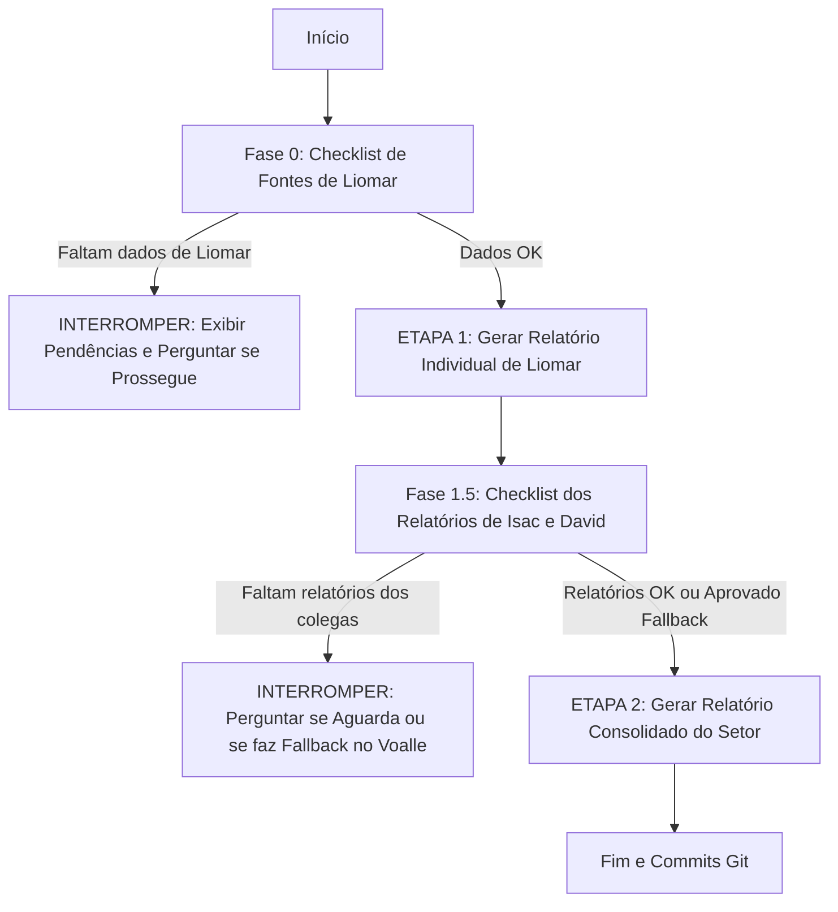

# 📋 PROMPT DE GERAÇÃO DE RELATÓRIOS SEMANAIS - SETOR DE TI

---

## ⚙️ 1. PARÂMETROS DA SEMANA (CAMPOS EDITÁVEIS PELO USUÁRIO)

> [!NOTE]
> Altere os campos abaixo a cada nova semana antes de solicitar a execução da IA.

* **Data Inicial:** `2026-09-01`
* **Data Final:** `2026-09-13`
* **Colaborador Principal (Responsável pela Consolidação):** Liomar Antonio de Oliveira

### 📝 Instruções e Focos Específicos Desta Semana (Customizável):

<!-- Digite aqui orientações contextuais ou pontos de atenção para a execução corrente -->

1. **Relatório de Visitas Presenciais e Veículos:** Ler obrigatoriamente o arquivo [1.voalle/Relatório de Visita Técnica Presencial - Setor TI.md](<file:///home/liomarti/dev/reports_ti/1.voalle/Relat%C3%B3rio%20de%20Visita%20T%C3%A9cnica%20Presencial%20-%20Setor%20TI.md>) e mapear os deslocamentos com veículos da empresa realizados no período de setembro/2026 para alimentar o Tópico 2.5.

   1. Obs.: Caso não hajam dados neste arquivo para o período selecionado, deverá identificar se houveram atendimentos presenciais nos demais dados que serão lidos e incluir neste tópico.
2. **Painéis de BI com Parceiros (Tópico 2.3):** Manter a justificativa factual real:

   - **Analítica 3M:** Acesso limitado de Liomar; o setor de TI não gerencia e não realiza acompanhamento direto da integração. Ficou pendente de o coordenador de TI Isvi Neemias solicitar a inclusão do meu contato no grupo de WhatsApp para esta demanda.
   - **EasyBI (MW Solutions):** Acesso nunca recebido funcionalmente, link inacessível por DNS (`https://easybi.teninternet.com.br`), sem participação em grupos e fora do escopo direto de atuação do TI.
     - Demanda futura para estes dois BIs (conforme orientações do coordenador):
       - "Vamos verificar as telas pra ajustar o que for necessário. Mas o principal foco: Quero construir uma tela pra o TI, assim como estamos construindo para outros setores (somente no Analítica 3M, por enquanto)."
       - "Criar um documento/escopo e solicitar aos BIs para criar a tela, até para termos um benchmarking entre a construção de cada empresa"
       - "Se um dia, a tela de BI puder substituir ou servir como principal fonte de dados dos relatórios, vai ser ótimo."
3. **Mérito do AutoTickets:** Os arquivos `.csv` em [2.autotickets/](file:///home/liomarti/dev/reports_ti/2.autotickets/) são dados tratados, filtrados e preparados pelo próprio sistema AutoTickets para auditoria.

### 📌 Tarefas Extras Pontuais Desta Semana (Customizável):

<!-- Adicione novas tarefas ou tópicos avulsos que surjam nesta semana -->

- [ ] Validar correções recentes no driver da ONT Parks e Datacom implementadas no AutoTickets.
- [ ] Mapear status da migração para o Slack e contas de e-mail criadas.

---

## 🚦 2. GATEKEEPER E FLUXO DE EXECUÇÃO EM DUAS ETAPAS

A IA deve seguir rigorosamente a execução em duas etapas com **validação prévia de fontes (Gatekeeper)**:

### Fase 0: Checklist de Pré-Requisitos (Fontes de Liomar)

Antes de gerar o relatório individual de Liomar, a IA deve validar:

- [ ] **Voalle (`1.voalle/`):** Arquivo PDF/CSV cobrindo o período da semana.
- [ ] **AutoTickets Local (`/home/liomarti/dev/autotickets-v2`):** Commits no período via `git log`.
- [ ] **AutoTickets CSVs (`2.autotickets/*.csv`):** Arquivos de chamados e tarefas atualizados.
- [ ] **WhatsApp (`3.whatsapp_histories/database/msgstore.db`):** Mensagens cobrindo as datas da semana. (Este database é do WhatsApp do setor de TI, ou seja, os 3 colaboradores utilizam e nem sempre as mensagens possuem indicador de quem respondeu. Tratar como demanda geral atendida pelo setor quando não houver identificação de quem atendeu às demandas identificadas aqui.)

> [!WARNING]
> **Ponto de Interrupção 1:** Caso falte qualquer uma das fontes acima para Liomar, a IA **DEVE INTERROMPER** a execução imediatamente, listar em tabela o status de cada fonte e perguntar se o usuário deseja prosseguir com dados parciais ou aguardar atualização.

---

### ETAPA 1: Relatório Individual de Liomar Oliveira

1. **Mineração:** Cruzar os dados de Voalle, commits do AutoTickets e histórico do WhatsApp.
2. **Estrutura:** Seguir rigorosamente o padrão do [modelo_coordenador](file:///home/liomarti/dev/reports_ti/modelo_coordenador/modelo_relatorio_setor_ti.pdf) (não utilizar versões em `liomar/old/`).
3. **Formatos de Saída:** Salvar os 3 arquivos em `0.individual_report/liomar/[data_inicio]-[data_fim].[ext]` (`.md`, `.html` estilizado e `.pdf` executivo A4).

---

### Fase 1.5: Validação dos Colegas (Gatekeeper de Consolidação)

Antes de gerar o consolidado, a IA deve verificar:

- [ ] Relatório de **Isac Costa Silva** em `0.individual_report/isac/[data_inicio]-[data_fim].[ext]`.
- [ ] Relatório de **David Brasil Fernandes** em `0.individual_report/david/[data_inicio]-[data_fim].[ext]`.

> [!WARNING]
> **Ponto de Interrupção 2:** Se faltar o relatório individual de Isac ou David:
>
> 1. A IA deve **PARAR** a execução;
> 2. Informar quais relatórios não foram encontrados para o período;
> 3. Perguntar interativamente:
>    - *(Opção A)* Aguardar o usuário inserir os relatórios pendentes;
>    - *(Opção B)* Prosseguir realizando a mineração direta das atividades dos colegas no Voalle (`1.voalle/` e `2.autotickets/`) e WhatsApp.

---

### ETAPA 2: Relatório Semanal Consolidado do Setor de TI

1. **Consolidação das Entregas:** Integrar Liomar, Isac e David no documento consolidado.
2. **Ações Conjuntas:** Quando mais de um colaborador atuou na mesma demanda, descrever em relato único indicando a participação de cada um.
3. **Formatos de Saída:** Salvar em `4.weekly_reports/report_ti-[data_inicio]-[data_fim].[ext]` (`.md`, `.html` estilizado e `.pdf` executivo A4).

---

## 📊 3. DIRETRIZES E COMPLEMENTOS AO MODELO DA COORDENAÇÃO

Para evitar redundâncias, a estrutura base dos **Tópicos 2.1 a 2.8** deve seguir fielmente o comunicado oficial em [modelo_coordenador/modelo_relatorio_setor_ti.pdf](file:///home/liomarti/dev/reports_ti/modelo_coordenador/modelo_relatorio_setor_ti.pdf).

A IA deve incluir obrigatoriamente os seguintes **complementos analíticos exclusivos** (que não constam no modelo original):

### Complemento ao Tópico 2.2 (Registro de Atividades por Membro):

- **Colaborador de TI Mais Ativo no Voalle:** Gráfico comparativo e ranking de apontamentos/horas registradas no sistema entre os 3 integrantes.

### Complemento ao Tópico 2.3 (Projetos e Entregas):

- **Esclarecimento Factual de BI:** Justificar formalmente o status real de Analítica 3M e EasyBI (MW Solutions) conforme informado na Seção 1.

### Complementos ao Tópico 2.5 (Suporte Interno / Informática):

- **Setores que mais demandaram suporte do TI:** Gráfico e ranking de interações por departamento (Marketing, Cobrança, Financeiro, Estoque, etc.).
- **Colaboradores que mais abriram chamados:** Ranking nominal identificando equipe e setor de cada solicitante.
- **Relatório de Visitas Presenciais e Veículos:** Subtópico detalhado com data, protocolo, técnico responsável, veículo utilizado, motivo e observações sobre o estado da frota (extraído de `1.voalle/Relatório de Visita Técnica Presencial - Setor TI.md`).

### Complemento ao Tópico 2.6 (Suporte ao Técnico de Campo):

- **Métricas ServiceDesk WhatsApp:** Quantitativo de apoios extraídos do grupo `ServiceDesk Suporte ao técnico` via `query_history.py --category campo`, detalhando provisionamento de ONTs, consultas de CTO e troca de estrutura.

---

## ⚖️ 4. REGRAS EXPLÍCITAS DE AUDITORIA E FIDEDIGNIDADE

1. **Fidelidade Total aos Fatos:** Nunca inventar dados, estimativas ou ocorrências. O relatório deve ser 100% comprovável.
2. **Fontes Auditáveis Obrigatórias:** Toda afirmação deve vir acompanhada de sua origem precisa:
   - Protocolo Voalle (ex.: `Protocolo #3183637`);
   - Hash de commit do Git no AutoTickets (ex.: `commit a1b2c3d`);
   - Timestamp e canal de WhatsApp (ex.: `ServiceDesk, 08/09 às 09:50`).
3. **Ausência Justificada:** Caso não hajam demandas compatíveis em um tópico obrigatório no período, registrar formalmente a justificativa em vez de omitir o tópico ou inventar dados.
4. **Sem Distorções:** Preservar rigorosamente o teor técnico e operacional dos relatos da equipe.
5. **Commits Automáticos:** Ao finalizar qualquer etapa ou geração de relatório, commitar imediatamente as alterações no Git conforme definido no `GEMINI.md`.
