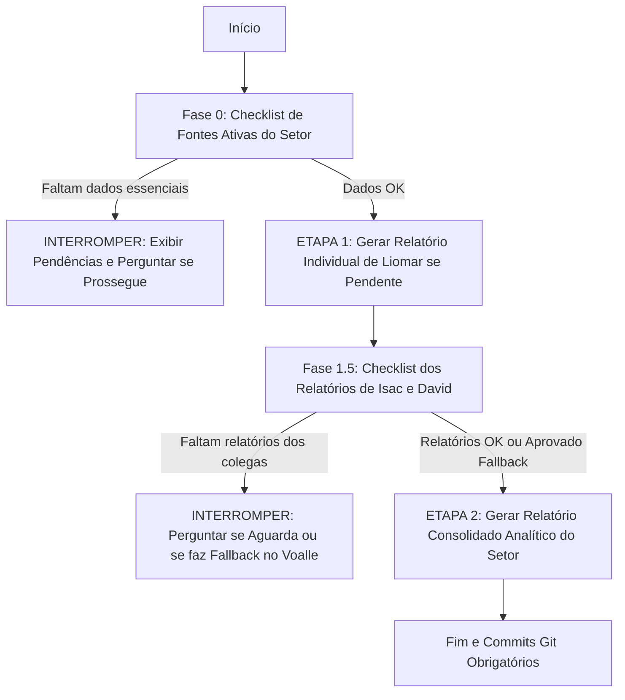

# 📋 PROMPT DE GERAÇÃO DE RELATÓRIOS SEMANAIS - SETOR DE TI

---

## ⚙️ 1. PARÂMETROS DA SEMANA (CAMPOS EDITÁVEIS PELO USUÁRIO)

> [!NOTE]
> Altere os campos abaixo a cada nova semana antes de solicitar a execução da IA.

* **Data Inicial (Domingo Oficial):** `2026-10-04`
* **Data Final (Sábado Oficial):** `2026-10-10`
* **Período Operacional Efetivo do TI (Segunda a Sexta):** `2026-10-05` a `2026-10-09`
* **Colaborador Principal (Responsável pela Consolidação):** Liomar Antonio de Oliveira

### 📝 Instruções e Focos Específicos Desta Semana (Customizável):

<!-- Digite aqui orientações contextuais ou pontos de atenção para a execução corrente -->

1. **Relatório de Visitas Presenciais e Veículos:** Identificar nas fontes de dados por serviços que exigiram deslocamentos com veículos da empresa, para alimentar o subtópico de visitas em Suporte Interno e detalhar a pontualidade/disponibilidade da frota.
2. **Impacto e Produtividade do AutoTickets:** Mapear os relatórios analíticos de `2.autotickets/` (WiFeed Vouchers, Fullcam Inadimplência/Instalação e Produtividade Geral), quantificando horas técnicas economizadas e clientes sincronizados.
3. **Investigações de Segurança e Vulnerabilidades:** Verificar se há documentação técnica no período em `2.1.others/` para integrar aos tópicos de segurança e projetos.

---

## 🚦 2. GATEKEEPER E FLUXO DE EXECUÇÃO EM DUAS ETAPAS

A IA deve seguir rigorosamente a execução em duas etapas com **validação prévia de fontes (Gatekeeper)**:

### Fase 0: Checklist de Pré-Requisitos (Fontes Ativas)

> [!NOTE]
> **Aproveitamento de Relatório Existente:** Caso já exista arquivo de relatório para o colaborador no período em `0.individual_report/[colaborador]/` (em formato `.pdf`, `.md` ou `.html`), **não é necessário gerar um novo relatório individual**. O arquivo existente deve ser aproveitado e considerado diretamente na confecção do relatório semanal em `4.weekly_reports/`.

Antes de gerar o relatório individual de Liomar (caso ainda não exista para o período), a IA deve validar:

- [ ] **Voalle (`1.voalle/liomar/`):** Arquivo de apontamentos e atendimentos no período em formato `.html`, `.pdf` ou `.csv`.
- [ ] **AutoTickets Local (`/home/liomarti/dev/autotickets-v2`):** Commits no período ou relatório de desenvolvimento de software.
- [ ] **AutoTickets Relatórios Analíticos (`2.autotickets/`):** Relatórios de produtividade, WiFeed, Fullcam ou colaboradores.
- [ ] **Investigações Pontuais (`2.1.others/`):** Verificar existência de pastas datadas da semana.
- [ ] **Feedbacks Anteriores (`5.feedback/`):** Leitura de apontamentos do Coordenador Isvi Neemias para garantir aderência às diretrizes.

> [!IMPORTANT]
> **Regra sobre `miscelaneous/`:** O diretório `miscelaneous/` (históricos de WhatsApp, gateway LiteLLM) é um repositório frio de apoio e **NÃO DEVE SER LIDO AUTOMATICAMENTE** nesta fase, exceto se solicitado expressamente nas instruções da semana.

> [!WARNING]
> **Ponto de Interrupção 1:** Caso falte qualquer uma das fontes ativas essenciais para Liomar (e ele não possua relatório existente no período), a IA **DEVE INTERROMPER** a execução imediatamente, listar em tabela o status de cada fonte e perguntar se o usuário deseja prosseguir com dados parciais ou aguardar atualização.

---

### ETAPA 1: Relatório Individual de Liomar Oliveira

*(Pular esta etapa se já existir relatório individual de Liomar para o período em `0.individual_report/liomar/`)*

1. **Mineração:** Cruzar os dados de Voalle, commits do AutoTickets, tarefas de banco de dados e investigações.
2. **Estrutura:** Seguir rigorosamente o padrão analítico e o modelo de tópicos oficiais.
3. **Formatos de Saída:** Salvar os 3 arquivos em `0.individual_report/liomar/[data_inicio]_[data_fim].[ext]` (`.md`, `.html` estilizado e `.pdf` executivo A4).

---

### Fase 1.5: Validação dos Colegas (Gatekeeper de Consolidação)

Antes de gerar o consolidado, a IA deve verificar se os colegas já possuem relatórios para o período:

- [ ] Relatório de **Isac Costa Silva** em `0.individual_report/isac/[data_inicio]_[data_fim].[ext]`.
- [ ] Relatório de **David Brasil Fernandes** em `0.individual_report/david/[data_inicio]_[data_fim].[ext]`.

> [!TIP]
> Se o arquivo de Isac ou David já existir (seja `.pdf`, `.md` ou `.html`), ele é considerado pronto: **não é gerado novo relatório** e suas informações são integradas diretamente ao consolidado semanal.

> [!WARNING]
> **Ponto de Interrupção 2:** Se faltar o relatório individual de Isac ou David:
>
> 1. A IA deve **PARAR** a execução;
> 2. Informar quais relatórios não foram encontrados para o período;
> 3. Perguntar interativamente:
>    - *(Opção A)* Aguardar o usuário inserir os relatórios pendentes;
>    - *(Opção B)* Prosseguir realizando a mineração direta das atividades dos colegas no Voalle (`1.voalle/[colaborador]/`) e relatórios do AutoTickets.

---

### ETAPA 2: Relatório Semanal Consolidado do Setor de TI

1. **Profundidade Analítica (PROIBIDO RESUMIR EXCESSIVAMENTE):** O relatório consolidado deve ser denso, detalhado e aprofundado, cobrindo detalhadamente cada tópico e subtópico com métricas, causas raízes, soluções aplicadas, tabelas e contexto técnico. Não reduza as seções a tópicos genéricos de uma frase.
2. **Consolidação das Entregas e Preservação de Visão:** Integrar Liomar, Isac e David no documento consolidado. A visão detalhada do relatório individual de Liomar deve ser rigorosamente preservada e expandida com as atividades de Isac e David.
3. **Ações Conjuntas:** Quando mais de um colaborador atuou na mesma demanda, descrever em relato unificado indicando a participação e responsabilidade de cada um.
4. **Formatos de Saída:** Criar o subdiretório dedicado para a semana em `4.weekly_reports/[data_inicio]_[data_fim]/` (onde o padrão de data é Domingo a Sábado) e salvar os arquivos no padrão `report_ti-[data_inicio]-[data_fim].[ext]` (`.md`, `.html` estilizado e `.pdf` executivo A4).

---

## 📐 3. ESTRUTURA HIERÁRQUICA E DIRETRIZES VISUAIS DO RELATÓRIO CONSOLIDADO

### 🎨 3.1 Moldura do Topo e Bloco Institucional

A moldura de abertura do documento deve seguir estritamente o padrão corporativo:

* **Título Principal:** Relatório Semanal Consolidado - Setor TI
* **Subtítulo:** Panorama Operacional, Gestão de Demandas, Incidentes, Infraestrutura Crítica e Outros
* **Bloco de Identificação Executiva (Grid Corporativo em Tabela):**
  - **Período Oficial (Diretoria):** `[Data Inicial Domingo] a [Data Final Sábado] (Semana XX / AAAA)`
  - **Período Operacional Efetivo do TI:** `[Segunda-feira] a [Sexta-feira] (Expediente Útil do Setor)`
  - **Coordenador de TI:** `Isvi Neemias`
  - **Responsável pela Consolidação:** `Liomar Antonio de Oliveira (Analista de TI Sênior — ID #107184)`
  - **Equipe Integrada:** `Liomar Oliveira, Isac Costa Silva e David Brasil Fernandes`

### 📑 3.2 Paginação, Diagramação e Renderização PDF

1. **Remoção de Cabeçalho/Rodapé do Navegador no PDF:**
   - Na geração do PDF via Chromium/Playwright, utilizar obrigatoriamente o parâmetro `--no-pdf-header-footer` (ou equivalente no CSS com `@page { margin: 15mm 12mm 15mm 12mm; }`), evitando que datas automáticas e caminhos locais (`file:///...` ou numerações `1/2`) poluam o cabeçalho e rodapé.
   - O próprio design HTML/CSS deve gerenciar cabeçalhos e numeração de página de forma interna e elegante.
2. **Quebra de Página por Tópico Principal:**
   - Cada tópico principal deve iniciar em uma nova página através de quebras de página explícitas (`page-break-before: always;` / `break-before: page;`).
3. **Recursos Visuais Obrigatórios:**
   - **Statcards:** No início de cada seção quantitativa, exibir cards com métricas-chave destacadas (números totais, balanço de fila, horas economizadas).
   - **Gráficos Visuais (CSS/SVG nativos):** Gráficos de barras proporcionais e distribuição setorial (pizza/donut em SVG puro ou CSS flex/grid).
   - **Tabelas Completas e Ricas:** Listagens estruturadas contendo Protocolo/ID, Solicitante/Setor, Descrição Técnica, Responsável e Status.

---

### 📂 3.3 Índice Geral de Navegação (com Links Âncoras 100% Funcionais)

O relatório deve conter um **Índice Completo** no início, com links internos rigorosamente correspondentes aos títulos do corpo do texto:

* [Resumo Executivo](#resumo-executivo)
* [⭐ Fatos Notáveis e Anomalias da Semana](#-fatos-notáveis-e-anomalias-da-semana)
* [1. Gestão de Demandas](#1-gestão-de-demandas)
  * [1.1 Demandas Pendentes](#11-demandas-pendentes)
  * [1.2 Demandas em Andamento](#12-demandas-em-andamento)
  * [1.3 Demandas Concluídas](#13-demandas-concluídas)
  * [1.4 Demandas Novas](#14-demandas-novas)
    * [1.4.1 Comparativo Entradas × Saídas (Balanço da Fila)](#141-comparativo-entradas--saídas-balanço-da-fila)
* [2. Registro de Atividades por Membro da Equipe](#2-registro-de-atividades-por-membro-da-equipe)
  * [2.1 David Brasil Fernandes](#21-david-brasil-fernandes)
    * [2.1.1 Resumo das Atividades](#211-resumo-das-atividades)
    * [2.1.2 Distribuição do Tempo](#212-distribuição-do-tempo)
    * [2.1.3 Desenvolvimento e Capacitação](#213-desenvolvimento-e-capacitação)
  * [2.2 Isac Costa Silva](#22-isac-costa-silva)
    * [2.2.1 Resumo das Atividades](#221-resumo-das-atividades)
    * [2.2.2 Distribuição do Tempo](#222-distribuição-do-tempo)
    * [2.2.3 Desenvolvimento e Capacitação](#223-desenvolvimento-e-capacitação)
  * [2.3 Liomar Antonio de Oliveira](#23-liomar-antonio-de-oliveira)
    * [2.3.1 Resumo das Atividades](#231-resumo-das-atividades)
    * [2.3.2 Distribuição do Tempo](#232-distribuição-do-tempo)
    * [2.3.3 Desenvolvimento e Capacitação](#233-desenvolvimento-e-capacitação)
  * [2.4 Desempenho no Voalle e Confronto com Jornada Real (Pontomais)](#24-desempenho-no-voalle-e-confronto-com-jornada-real-pontomais)
* [3. Projetos e Entregas](#3-projetos-e-entregas)
  * [3.1 Projeto AutoTickets v2 (RADIUS, Automações e Provisionamento)](#31-projeto-autotickets-v2)
    * [3.1.1 Status e Andamento](#311-status-e-andamento)
    * [3.1.2 Entregas em Produção e Resultados](#312-entregas-em-produção-e-resultados)
    * [3.1.3 Distribuição do Tempo do Projeto](#313-distribuição-do-tempo-do-projeto)
    * [3.1.4 Impacto Operacional e Métricas de Produtividade das Automações](#314-impacto-operacional-e-métricas-de-produtividade-das-automações)
  * [3.2 Projetos de Conectividade e Redes (WireGuard, SSH e Hardening)](#32-projetos-de-conectividade-e-redes)
  * [3.3 Painéis de BI com Parceiros (Analítica 3M e EasyBI / MW Solutions)](#33-painéis-de-bi-com-parceiros)
* [4. Incidentes Tratados](#4-incidentes-tratados)
* [5. Suporte Interno (Informática)](#5-suporte-interno-informática)
  * [5.1 Relação de Atendimentos e Chamados da Semana](#51-relação-de-atendimentos-e-chamados-da-semana)
  * [5.2 Setores que mais Demandaram Atendimento](#52-setores-que-mais-demandaram-atendimento)
  * [5.3 Colaboradores Solicitantes Mais Frequentes](#53-colaboradores-solicitantes-mais-frequentes)
  * [5.4 Relatório de Visitas Técnicas Presenciais e Gestão de Veículos](#54-relatório-de-visitas-técnicas-presenciais-e-gestão-de-veículos)
* [6. Suporte ao Técnico de Campo](#6-suporte-ao-técnico-de-campo)
  * [6.1 Volumetria de Solicitações (Com e Sem Protocolo)](#61-volumetria-de-solicitações-com-e-sem-protocolo)
  * [6.2 Tipos de Apoio Mais Frequentes e Tempo de Resposta](#62-tipos-de-apoio-mais-frequentes-e-tempo-de-resposta)
  * [6.3 Oportunidades de Automação e Redução de Dependência](#63-oportunidades-de-automação-e-redução-de-dependência)
* [7. Infraestrutura e Sistemas Críticos](#7-infraestrutura-e-sistemas-críticos)
  * [7.1 Disponibilidade de Serviços e Incidentes em Sistemas](#71-disponibilidade-de-serviços-e-incidentes-em-sistemas)
  * [7.2 Execução e Validação de Backups](#72-execução-e-validação-de-backups)
  * [7.3 Atualizações, Melhorias e Ações de Modernização](#73-atualizações-melhorias-e-ações-de-modernização)
* [8. Pontos de Atenção e Próximas Ações](#8-pontos-de-atenção-e-próximas-ações)
  * [8.1 Riscos Tecnológicos e Vulnerabilidades Identificadas](#81-riscos-tecnológicos-e-vulnerabilidades-identificadas)
  * [8.2 Necessidades de Investimentos e Aquisições](#82-necessidades-de-investimentos-e-aquisições)
  * [8.3 Ações Planejadas para as Próximas Semanas](#83-ações-planejadas-para-as-próximas-semanas)

---

### 📝 3.4 Conteúdo Detalhado por Tópico

#### Resumo Executivo
Visão geral analítica da semana: síntese das principais entregas de engenharia de software e infraestrutura, quantitativo global de chamados e suportes a técnicos, principais conquistas e prioridades operacionais para a próxima semana.

#### ⭐ Fatos Notáveis e Anomalias da Semana
Seção obrigatória dedicada ao aprofundamento de ocorrências incomuns. Para cada fato notável identificado no período (desvio de planejamento, atraso de frota, falha física atípica, contestação indevida de cliente ou incidente de segurança):
- **Ocorrência e Ativos Envolvidos:** O que aconteceu, data e equipamentos/sistemas impactados.
- **Causa Raiz Técnica e Contexto:** Por que ocorreu e fatores determinantes.
- **Impacto Operacional:** Horas perdidas, retrabalho ou risco gerado.
- **Tratativa Aplicada:** Medida de contenção imediata ou definitiva.
- **Recomendação e Próximo Passo:** Ação estruturante recomendada para evitar repetição.

#### 1. Gestão de Demandas
- **1.1 Demandas Pendentes:** Demandas paradas ou na fila aguardando início, informando ID/Protocolo, solicitante, prioridade técnica e data prevista.
- **1.2 Demandas em Andamento:** Atividades em execução, indicando responsável direto, percentual de avanço estimado, bloqueios técnicos ou dependências de terceiros e previsão de conclusão.
- **1.3 Demandas Concluídas:** Todas as entregas finalizadas na semana com detalhamento do resultado prático obtido. Demandas de rotina repetitiva de mesma natureza (ex.: análises periciais de desconto de fatura ou atribuições de IP público) podem ser sintetizadas com contagem total e amostragem de protocolos.
- **1.4 Demandas Novas:** Demandas abertas durante o período avaliado.
  - **1.4.1 Comparativo Entradas × Saídas (Balanço da Fila):** Análise quantitativa demonstrando se a fila de trabalho do setor está crescendo ou reduzindo (com statcards e balanço líquido). **PROIBIDO usar o termo "resolutividade".**

#### 2. Registro de Atividades por Membro da Equipe
Para cada colaborador (**2.1 David Brasil Fernandes**, **2.2 Isac Costa Silva** e **2.3 Liomar Antonio de Oliveira**), detalhar:
- **Resumo das Atividades:** Narrativa aprofundada dos chamados, projetos e intervenções técnicas realizadas.
- **Distribuição do Tempo:** Percentual de alocação entre frentes (Projetos, Suporte Interno, Suporte ao Campo, Infraestrutura e Rotinas Administrativas).
- **Desenvolvimento e Capacitação:** Dificuldades observadas, pontos fortes demonstrados e necessidades de treinamento identificadas.
- **2.4 Desempenho no Voalle e Confronto com Jornada Real (Pontomais):**
  - Tabela comparando Horas no Voalle x Horas no Pontomais.
  - Justificativa técnica obrigatória para divergências (cronômetros de tickets abertos, sobreposição de demandas em paralelo, deslocamentos ou atendimentos em intervalos).

#### 3. Projetos e Entregas
- **3.1 Projeto AutoTickets v2 (RADIUS, Automações e Provisionamento):**
  - **3.1.1 Status e Andamento:** Fases do ciclo de vida, volume de commits e testes executados.
  - **3.1.2 Entregas em Produção:** Features e integrações disponibilizadas e resultados imediatos.
  - **3.1.3 Distribuição do Tempo:** Horas estimadas dedicadas ao desenvolvimento.
  - **3.1.4 Impacto Operacional e Métricas de Produtividade das Automações:**
    - Subtópico obrigatório quantificando as horas técnicas economizadas pelas automações ativas (ex.: WiFeed Vouchers, esteira Fullcam, etc.).
    - Detalhamento de volume de clientes sincronizados, churn evitado e validação de base.
- **3.2 Projetos de Conectividade e Redes:** WireGuard, MikroTik, hardening e SIEM Wazuh. Justificar qualquer desvio de rota ou mudança de prioridade técnica.
- **3.3 Painéis de BI com Parceiros:** Esclarecimento formal do status real de **Analítica 3M** (Perfil Master para gestão de usuários, escopo estratégico) e **EasyBI / MW Solutions** (fora do escopo direto, descontinuação contratual).

#### 4. Incidentes Tratados
Detalhamento de cada incidente ocorrido na semana:
- Identificação, sistema afetado, severidade, data/hora e impacto.
- Causa raiz técnica identificada e solução adotada (definitiva ou paliativa).
- **Janela de Reincidência:** Adotar janela móvel de **30 dias de observação** antes de declarar ausência de reincidência.

#### 5. Suporte Interno (Informática)
- **5.1 Relação de Atendimentos e Chamados:** Análise dos atendimentos a usuários internos (estações de trabalho, acessos, e-mails, sistemas operacionais e periféricos), com tabela e detalhamento técnico.
- **5.2 Setores que mais Demandaram:** Ranking e gráfico visual dos departamentos mais demandantes.
- **5.3 Colaboradores Solicitantes Mais Frequentes:** Ranking nominal identificando setor e tipo de demanda.
- **5.4 Relatório de Visitas Técnicas Presenciais e Gestão de Veículos:** Detalhamento de deslocamentos operacionais, quilometragem, veículos utilizados e **avaliação da frota** (atrasos na liberação, impactos no cumprimento de cronogramas e tempo perdido). Justificar instalações de Windows 10 considerando o fim do suporte oficial.

#### 6. Suporte ao Técnico de Campo
- **6.1 Volumetria de Solicitações:** Quantidade total de apoios prestados via ServiceDesk e Voalle, reforçando a diretriz de abertura de protocolo formal para todo suporte com atuação em sistema ou análise.
- **6.2 Tipos de Apoio Mais Frequentes e Tempo Médio de Resposta:** Provisionamento de ONTs Datacom/Parks, manobras de CTO, consultas cadastrais, liberação de portas e trocas de estrutura. A soma da tabela de categorias deve corresponder exatamente ao total relatado.
- **6.3 Oportunidades de Automação e Capacitação:** Propostas de melhorias no AutoTickets ou capacitação para os técnicos reduzirem a dependência do TI.

#### 7. Infraestrutura e Sistemas Críticos
- **7.1 Disponibilidade de Serviços e Incidentes em Sistemas:**
  - Sem ferramenta de monitoramento externo medindo o tempo fora do ar, declarar expressamente **"Sem indisponibilidade de rede registrada"**.
  - Registrar falhas funcionais (como bugs de sessão no Voalle) como **Ocorrências Operacionais de Sistemas**, sem distorcer o uptime de rede.
- **7.2 Execução e Validação de Backups:**
  - Apresentar o quadrante de governança: total de VMs/CTs na rotina, jobs executados x falhas na semana, falhas refeitas manualmente com justificativa e data do último teste de Disaster Recovery.
- **7.3 Atualizações, Melhorias e Ações de Modernização:** Aplicações de patches, manutenção física preventiva (ex.: Dell R910, nobreaks NHS) e estudos de segurança (integrar dados de `2.1.others/`).

#### 8. Pontos de Atenção e Próximas Ações
- **8.1 Riscos Tecnológicos e Vulnerabilidades Identificadas:** Registro aprofundado de vulnerabilidades críticas, riscos de conformidade (LGPD, planos gratuitos de ferramentas) e segurança.
- **8.2 Necessidades de Investimentos e Aquisições:** Equipamentos, licenças, nobreaks senoidais e peças de reposição.
- **8.3 Ações Planejadas para as Próximas Semanas:** Roadmap de entregas e cronograma de prioridades com prazos alinhados.

---

## ⚖️ 4. REGRAS EXPLÍCITAS DE AUDITORIA, FIDEDIGNIDADE E VERSIONAMENTO

1. **Fidelidade Total aos Fatos:** Nunca inventar dados, estimativas ou ocorrências. O relatório deve ser 100% comprovável através de evidências reais.
2. **Fontes Auditáveis Obrigatórias:** Toda afirmação deve vir acompanhada de sua origem precisa:
   - Protocolo Voalle (ex.: `Protocolo #3183637`);
   - Hash de commit do Git no AutoTickets (ex.: `commit a1b2c3d`);
   - Identificação de relatório analítico (ex.: `2.autotickets/wifeed_daily_update_voucher/`).
3. **Ausência Justificada:** Caso não hajam demandas compatíveis em um subtópico, registrar formalmente a justificativa técnica em vez de omitir o tópico ou simular atividades inexistentes.
4. **Preservação da Visão Individual:** O relatório semanal consolidado não deve canibalizar as entregas técnicas do relatório individual de Liomar, mas sim incorporá-las integralmente e enriquecê-las com a visão macro do setor.
5. **Commits Automáticos e Imediatos:** Toda alteração em documentos, relatórios ou no próprio `PROMPT.md` **DEVE SER OBRIGATORIAMENTE COMMITADA NO GIT** com mensagem clara e descritiva.
