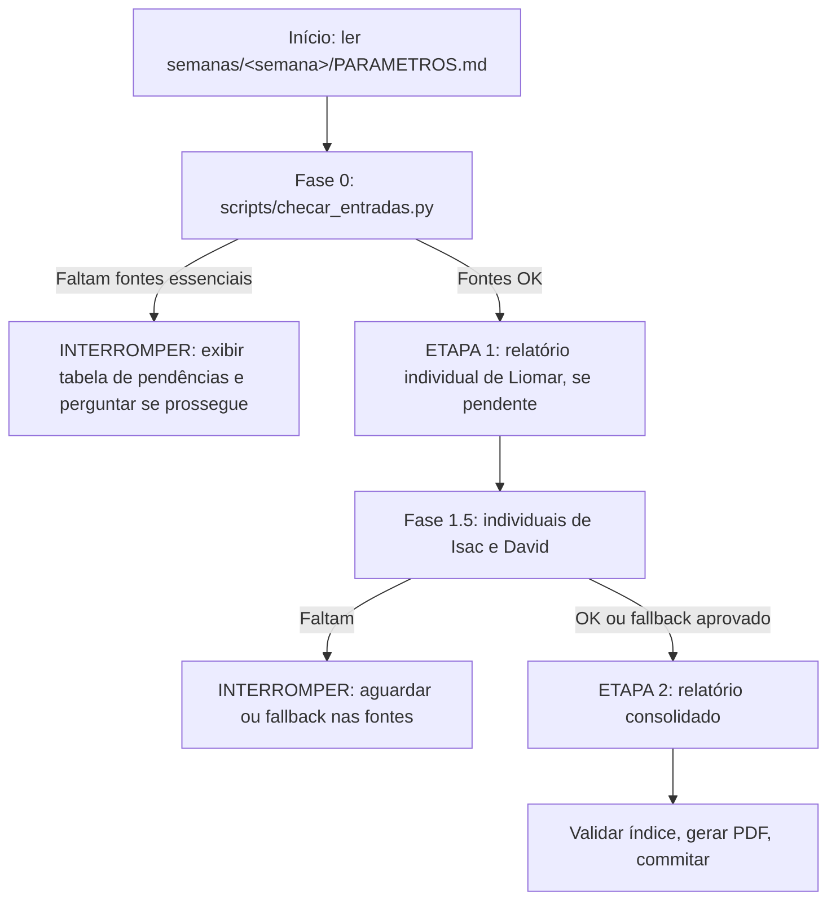

# 🚦 Fluxo de Geração do Relatório Semanal

Execução em duas etapas com **validação prévia de fontes (Gatekeeper)**. `<semana>` = pasta da semana corrente em `semanas/` (a mais recente).

---

## Preparação (usuário)

1. `bash scripts/nova_semana.sh` — cria `semanas/<Domingo>_<Sábado>/` com `PARAMETROS.md` e as subpastas (por padrão, a última semana completa).
2. Preencher os focos da semana em `PARAMETROS.md`.
3. Copiar as entradas para `fontes/` (nomes em `docs/fontes_de_dados.md`) e os individuais recebidos dos colegas para `individuais/`.
4. Mascarar CPFs das exportações brutas: `python3 scripts/mascarar_dados.py semanas/<semana>/fontes/**/*.{html,csv,md}`.

---

## Fase 0: Checklist de Pré-Requisitos

Rodar `python3 scripts/checar_entradas.py` (ou `... semanas/<semana>`) e apresentar a tabela ao usuário. O script verifica:

- `fontes/voalle/` — exportação de cada colaborador (`liomar`, `isac`, `david`) em `.html`, `.pdf` ou `.csv`.
- Commits do `/home/liomarti/dev/autotickets-v2` no período (ou relatório em `fontes/autotickets/desenvolvimento/`).
- `fontes/autotickets/` — `colaborador_x_ticket`, `wifeed_daily_update_voucher`, `fullcam_lucros_prejuizos`, `fullcam_automacao_inadimplencia`, `fullcam_automacao_instalacao_camera`.
- `fontes/investigacoes/` — estudos datados da semana (opcional).
- `individuais/` — relatórios já existentes.
- `feedback.md` da semana anterior (leitura obrigatória antes de gerar) e CPFs sem máscara.

> [!WARNING]
> **Ponto de Interrupção 1:** se faltar fonte essencial de Liomar (e não existir `individuais/liomar.*`), **interromper**, mostrar a tabela de status e perguntar se o usuário prossegue com dados parciais ou aguarda.

---

## ETAPA 1: Relatório Individual de Liomar

*(Pular se já existir `individuais/liomar.*`.)*

1. **Mineração:** cruzar Voalle, commits do AutoTickets, relatórios do AutoTickets e investigações.
2. **Estrutura:** seguir `docs/especificacao_relatorio.md` e `docs/regras_metricas.md`.
3. **Saída:** `individuais/liomar.md`, `individuais/liomar.html` (com `templates/report.css`) e `individuais/liomar.pdf` (`scripts/renderizar_pdf.sh`).

---

## Fase 1.5: Relatórios dos Colegas

- Se existir `individuais/isac.*` ou `individuais/david.*` (qualquer formato), ele é a fonte oficial do colaborador: **não gerar novo**, integrar ao consolidado.

> [!WARNING]
> **Ponto de Interrupção 2:** se faltar o individual de Isac ou David, **parar**, informar quais faltam e perguntar:
> - *(A)* aguardar o usuário inserir os relatórios; ou
> - *(B)* fallback: minerar `fontes/voalle/<pessoa>.*` e `fontes/autotickets/` e gerar `individuais/<pessoa>.{md,html,pdf}` antes de consolidar.

---

## ETAPA 2: Relatório Consolidado do Setor

1. **Profundidade analítica (proibido resumir excessivamente):** cada tópico e subtópico com métricas, causas raízes, soluções, tabelas e contexto técnico.
2. **Preservação da visão individual:** o consolidado incorpora integralmente as entregas do individual de Liomar e as expande com Isac e David.
3. **Ações conjuntas:** demanda com mais de um colaborador vira relato unificado indicando a participação de cada um.
4. **Saída:** `report_ti_<Domingo>_<Sábado>.md`, `.html` (com `templates/report.css`) e `.pdf`.

## Finalização

1. `python3 scripts/validar_indice.py semanas/<semana>/report_ti_*.md semanas/<semana>/report_ti_*.html` — corrigir qualquer âncora quebrada.
2. `bash scripts/renderizar_pdf.sh semanas/<semana>/report_ti_<...>.html` (idem para individuais gerados).
3. Commitar (o hook bloqueia dados sensíveis).
4. Quando chegar o parecer da Coordenação, salvar em `semanas/<semana>/feedback.md` e registrar as lições novas em `docs/licoes_aprendidas.md`.
