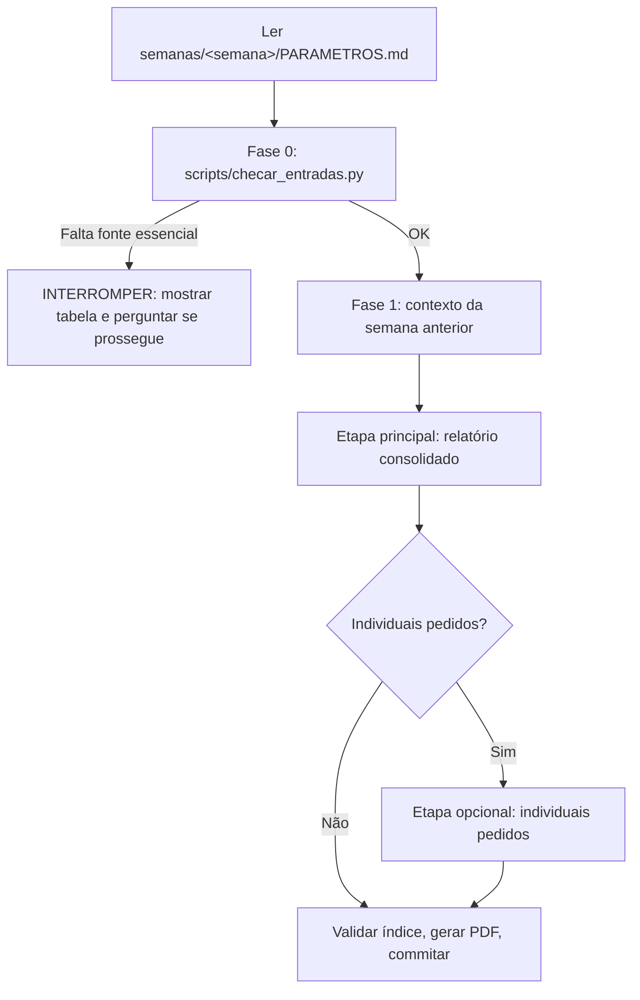

# 🚦 Fluxo de Geração do Relatório Semanal

`<semana>` = pasta da semana corrente em `semanas/` (a mais recente). `<anterior>` = a pasta imediatamente anterior.

> [!IMPORTANT]
> **Padrão: gerar somente o relatório semanal consolidado.** Relatórios individuais só são gerados quando o usuário pedir explicitamente, no prompt ou no campo **"Relatórios individuais a gerar"** do `PARAMETROS.md`.

---

## Preparação (usuário)

1. `bash scripts/nova_semana.sh` — cria `semanas/<Domingo>_<Sábado>/` com `PARAMETROS.md` e as subpastas.
2. Preencher em `PARAMETROS.md` os focos da semana, os feriados e, se quiser, os relatórios individuais a gerar.
3. Copiar as entradas para `fontes/` (nomes em `docs/fontes_de_dados.md`). Relatórios que os colegas enviarem vão para `individuais/` e servem como **fonte**.
4. *(Opcional)* Escrever as observações sobre o relatório anterior (suas e do Isvi) em `semanas/<anterior>/feedback.md`, a partir de `templates/feedback.md`.
5. Mascarar CPFs: `python3 scripts/mascarar_dados.py semanas/<semana>/fontes/voalle/* semanas/<semana>/fontes/autotickets/*/*`.

---

## Fase 0: Checklist de entradas

Rodar `python3 scripts/checar_entradas.py` e mostrar a tabela ao usuário. São essenciais: Voalle dos três colaboradores, commits do AutoTickets e os cinco relatórios principais do AutoTickets. Também aparecem, como informativos: o relatório e o `feedback.md` da semana anterior, os individuais já existentes e os CPFs sem máscara.

> [!WARNING]
> **Ponto de interrupção:** se faltar fonte essencial, **interromper**, mostrar a tabela e perguntar se o usuário prossegue com dados parciais (registrando a ausência justificada no relatório) ou aguarda.

---

## Fase 1: Contexto da semana anterior (obrigatória)

Ler, antes de escrever qualquer seção:

1. **`semanas/<anterior>/report_ti_*.md`** — o relatório consolidado anterior. Usar para:
   - **Continuidade:** cada item de *1.2 Demandas em andamento*, *1.1 Pendentes* e *9.3 Ações planejadas* do relatório anterior precisa ter **desfecho** no novo (concluído, em andamento com novo %, replanejado com motivo e novo prazo, ou cancelado com motivo).
   - **Comparação:** indicadores-chave da semana (balanço da fila, volumes, base WiFeed etc.) podem ser comparados com os da semana anterior. O valor anterior aparece sempre **identificado como "semana anterior"** e com a fonte (`semanas/<anterior>/report_ti_*.md`); nunca substitui o dado atual.
   - **Mudanças de plano:** desvio em relação ao que foi prometido entra com o motivo (`docs/regras_metricas.md` §8).
2. **`semanas/<anterior>/feedback.md`** *(se existir)* — parecer do Isvi e observações do Liomar. **Toda observação precisa ser tratada** no novo relatório: no tópico correspondente e na tabela *Acompanhamento das observações da semana anterior* do Resumo Executivo (`docs/especificacao_relatorio.md`).
3. **`docs/licoes_aprendidas.md`** — regras e pendências acumuladas da Coordenação.

---

## Etapa principal: Relatório consolidado do setor

1. **Fontes:** minerar diretamente `fontes/voalle/` (Liomar, Isac e David), `fontes/autotickets/`, os commits do `autotickets-v2` e `fontes/investigacoes/`. Se existir `individuais/<pessoa>.*` (enviado pelo colega ou gerado antes), usar como fonte complementar daquela pessoa.
2. **Profundidade analítica (proibido resumir excessivamente):** cada tópico e subtópico com métricas, causas raízes, soluções, tabelas e contexto técnico.
3. **Detalhamento por pessoa:** o Tópico 2 traz a visão completa de cada colaborador (atividades, distribuição do tempo, capacitação, Voalle × Pontomais), sem depender de relatório individual.
4. **Ações conjuntas:** demanda com mais de um colaborador vira relato unificado, indicando a participação de cada um.
5. **Saída:** `semanas/<semana>/report_ti_<Domingo>_<Sábado>.md`, `.html` (a partir de `templates/report.html`) e `.pdf`.

---

## Etapa opcional: Relatórios individuais (somente se pedido)

Executar **apenas** para as pessoas pedidas no prompt ou em `PARAMETROS.md`. Sem pedido, não gerar e não perguntar.

- **Conteúdo:** recorte do consolidado para a pessoa, mais o detalhamento completo dos protocolos e commits dela, seguindo a estrutura de tópicos aplicável.
- **Saída:** `individuais/<pessoa>.md`, `.html` (com o CSS em `../../../templates/report.css`) e `.pdf`.
- Se já existir `individuais/<pessoa>.*` enviado pelo colega, **não sobrescrever**: avisar o usuário.

---

## Finalização

1. `python3 scripts/validar_indice.py semanas/<semana>/report_ti_*.md semanas/<semana>/report_ti_*.html` — corrigir qualquer âncora quebrada.
2. `bash scripts/renderizar_pdf.sh semanas/<semana>/report_ti_<...>.html` (e para cada individual gerado).
3. Atualizar a seção de status do `PARAMETROS.md` da semana (o que foi gerado e o que ficou pendente).
4. Commitar (o hook bloqueia dados sensíveis).
5. Quando chegar o parecer da Coordenação: salvar em `semanas/<semana>/feedback.md` e registrar as lições novas em `docs/licoes_aprendidas.md`.
